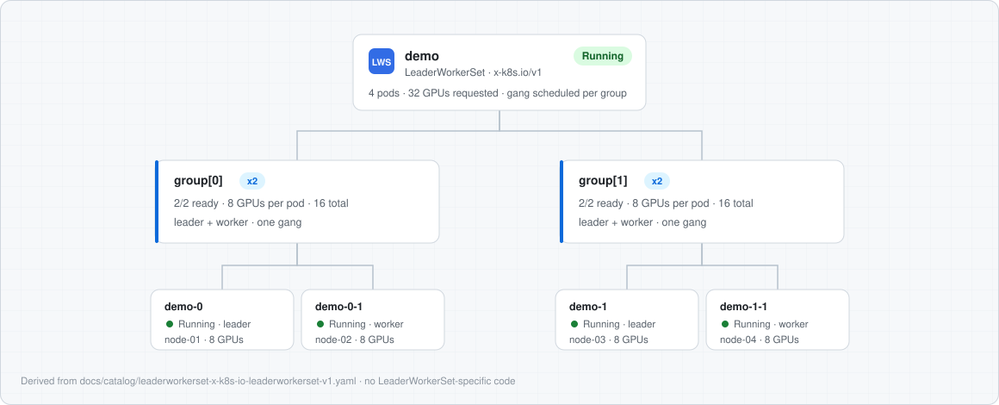

# Workload-Map (formerly Karta)

> **Repository move and rename notice:** On September 10, 2026, this repository
> moved from the run-ai GitHub organization to
> `dsx-ai-factory/karta`. On September 15, 2026, the project was renamed from
> Karta to Workload-Map to align with DSX OS naming conventions, and the
> repository moved again to
> [`dsx-ai-factory/workload-map`](https://github.com/dsx-ai-factory/workload-map).
> Existing repository URLs and standard Git operations continue to work through
> GitHub redirects. The Go module path has also moved to
> `github.com/dsx-ai-factory/workload-map`; update any pinned `go get` or import
> paths, GitHub Actions, webhooks, or other automation that reference
> `run-ai/karta` or `dsx-ai-factory/karta`. After v0.2.x the library moves again,
> into the nested module `github.com/dsx-ai-factory/workload-map/karta/sdk`.

**A standard way to describe the structure of any Kubernetes workload type.**

[](https://github.com/dsx-ai-factory/workload-map/actions/workflows/ci.yaml)
[](https://pkg.go.dev/github.com/dsx-ai-factory/workload-map/karta/sdk)
[](https://goreportcard.com/report/github.com/dsx-ai-factory/workload-map)
[](https://github.com/dsx-ai-factory/workload-map/releases)
[](LICENSE)

Karta lets you define a portable, declarative blueprint for any Kubernetes workload - whether it's a simple Deployment, a distributed PyTorchJob, or a custom CRD. Controllers and platforms can then use that blueprint to inspect, modify, and manage workloads without hard-coding knowledge of each type.

## The Problem

In Kubernetes, and especially in AI systems, a workload is not a standalone execution unit such as a single Pod. Instead, it is composed of multiple components organized in a complex hierarchy of resources, often exposed via custom resource definitions (CRDs) - for example: PyTorchJob, RayCluster, and MPIJob. Each of these CRDs structures the workload configuration differently, but they all share the same conceptual building blocks: pod specifications, scaling parameters, and status definitions.

If you're building a controller, scheduler, or platform that needs to work with multiple workload types, you end up writing bespoke logic for each one:

- Where is the pod template?
- How do I find the replica count?
- Which status conditions mean "running" vs "failed"?
- How do I modify the pod spec without breaking the workload?

This doesn't scale. Every new workload type means new integration code - schedulers, controllers, and platforms all end up maintaining per-CRD adapters that implement the same patterns over and over.

## The Solution

Karta (*a map to navigate resources*) introduces a CRD that maps the structure of any workload type into a standard schema. Using JQ-based path expressions, a Karta declaratively defines how to locate pod specifications, scaling parameters, and status fields within any workload hierarchy. Define it once, and any controller can use it to:

- **Extract** pod templates, replica counts, status, and metadata
- **Update** pod specs, labels, and annotations across all instances
- **Understand** workload hierarchy (e.g., a JobSet with master + worker groups)

In addition to the CRD, Karta provides a **Go package** that performs the core processing logic: query evaluation to dynamically interpret custom resource schemas, resource extraction that traverses workload hierarchies to identify and group pods, and optimization instruction processors that apply strategies such as gang scheduling to ensure coordinated placement of pods for distributed workloads.

```
┌──────────────────────────────────────────────────┐
│                   Your Platform                  │
│  (scheduler, controller, dashboard, CLI, etc.)   │
├──────────────────────────────────────────────────┤
│              Karta Component API                 │
│    Extract pods · Update specs · Read status     │
├────────────┬────────────┬────────────┬───────────┤
│ Karta:     │ Karta:     │ Karta:     │ Karta:    │
│ JobSet     │ RayCluster │ PyTorchJob │ YourCRD   │
└────────────┴────────────┴────────────┴───────────┘
```

## From YAML to Workload Tree

Here is a distributed inference workload the way a user submits it - a LeaderWorkerSet serving two model replicas, each a group of one leader pod and one worker pod:

```yaml
apiVersion: leaderworkerset.x-k8s.io/v1
kind: LeaderWorkerSet
metadata:
  name: demo
spec:
  replicas: 2        # two groups, one per model replica
  leaderWorkerTemplate:
    size: 2          # pods per group: 1 leader + 1 worker
    leaderTemplate:
      spec:
        containers:
        - name: inference-leader
          image: ghcr.io/example/inference:latest
          resources:
            limits:
              nvidia.com/gpu: 8
    workerTemplate:
      spec:
        containers:
        - name: inference-worker
          image: ghcr.io/example/inference:latest
          resources:
            limits:
              nvidia.com/gpu: 8
```

The groups, roles, replica counts, GPU requests, and status conditions are all in there, but nested in fields that only LeaderWorkerSet-aware code knows how to find. RayCluster, JobSet, and every other workload type nests the same information differently.

With the pre-built [LeaderWorkerSet Karta definition](docs/catalog/leaderworkerset-x-k8s-io-leaderworkerset-v1.yaml), any tool can resolve that object and its live pods into a uniform structural view:



The structure in this view comes from Karta path expressions: the group, leader, and worker components, their replica counts, the per-pod GPU counts, and the workload status mapped from LeaderWorkerSet conditions to a common vocabulary. The gang semantics come from the same definition's gang-scheduling instructions, which declare each group's pods as one gang. None of it is LeaderWorkerSet-specific code. Point the same code at a RayCluster or a JobSet with their Karta definitions and the view keeps working. [KAI Scheduler](https://github.com/kai-scheduler/KAI-Scheduler) consumes the gang instructions today through its Karta-based pod grouper to admit each gang all-or-nothing, and any scheduler with a gang primitive can translate them the same way.

## Quick Start

### Install the CLI

Install `kli` with Homebrew on macOS or Linux. This repository is its own tap,
so add it by URL once, then install by full name:

```bash
brew tap dsx-ai-factory/kli https://github.com/dsx-ai-factory/workload-map
brew install dsx-ai-factory/kli/kli
```

The URL is required because the short form of `brew tap` only resolves
repositories named `homebrew-<name>`. Installing by full name also makes
Homebrew trust this one cask, which it requires for any tap it does not
maintain. `brew upgrade kli` installs later releases.

Each release also publishes prebuilt `kli` archives for Linux and macOS on
amd64 and arm64, with a `checksums.txt` manifest, on the
[GitHub Releases page](https://github.com/dsx-ai-factory/workload-map/releases).
To install without Homebrew, download the archive for your platform, check it
against `checksums.txt`, and put the `kli` executable on your `PATH`.

Run `kli --version` to print the release version. `go install` is not a
supported way to install the CLI.

See the [CLI Guide](docs/CLI%20Guide.md) for shell completion and for installing
from a clone with make.

### Install the CRD

```bash
kubectl apply -f https://raw.githubusercontent.com/dsx-ai-factory/workload-map/main/charts/karta/crds/run.ai_kartas.yaml
```

### Use the Go library

```bash
go get github.com/dsx-ai-factory/workload-map/karta/sdk@latest
```

The library lives in the `karta/sdk/` module. Releases up to v0.2.x published it as
`github.com/dsx-ai-factory/workload-map`. To move to the new path, require
`github.com/dsx-ai-factory/workload-map/karta/sdk` and rewrite imports from
`github.com/dsx-ai-factory/workload-map/pkg/...` to
`github.com/dsx-ai-factory/workload-map/karta/sdk/pkg/...`.

### Define a Karta

Here's a Karta for a JobSet - a distributed training workload with master and worker groups:

```yaml
apiVersion: run.ai/v1alpha1
kind: Karta
spec:
  structureDefinition:
    rootComponent:
      name: jobset
      kind:
        group: jobset.x-k8s.io
        version: v1alpha2
        kind: JobSet
      statusDefinition:
        conditionsDefinition:
          path: .status.conditions
          typeFieldName: type
          statusFieldName: status
        statusMappings:
          running:
          - byExpression:
              expression: "(.status.replicatedJobsStatus // []) | any(.ready > 0 and .active > 0) and all(.failed == 0)"
              expectedResult: "true"
          completed:
          - byConditions:
            - type: Completed
              status: "True"
          failed:
          - byConditions:
            - type: Failed
              status: "True"

    childComponents:
    - name: replicatedjob
      kind:
        group: batch
        version: v1
        kind: Job
      ownerRef: jobset
      specDefinition:
        podTemplateSpecPath: .spec.replicatedJobs[].template.spec.template
      scaleDefinition:
        replicasPath: .spec.replicatedJobs[] | .replicas * .template.spec.parallelism
      instanceIdPath: .spec.replicatedJobs[].name  # Instances: "master", "worker"
```

### Extract workload information

```go
import "github.com/dsx-ai-factory/workload-map/karta/sdk/pkg/resource"

// Create a factory from your Karta and workload object
factory := resource.NewComponentFactoryFromObject(karta, jobSetObject)

// Get the child component which has the per-instance data
component, _ := factory.GetComponent("replicatedjob")
summaries, _ := component.GetExtractedInstances(ctx)

// Access pod template specs, metadata, and scale info for each instance
for instanceID, summary := range summaries {
    // instanceID will be "master" or "worker"
    if summary.PodTemplateSpec != nil {
        fmt.Printf("Instance %s image: %s\n", instanceID, summary.PodTemplateSpec.Spec.Containers[0].Image)
    }
}

// Get status from the root component
rootComponent, _ := factory.GetRootComponent()
status, _ := rootComponent.GetStatus(ctx)
// status.MatchedStatuses: matched statuses based on conditions (e.g., ["running"])
// status.Phase: raw phase string from the workload
// status.Conditions: []Condition with Type, Status, Message fields
```

### Update workload specs

The same paths defined in `specDefinition` are used for both extraction and updates:

```go
// Prepare updates per instance
updates := map[string]resource.FragmentedPodSpec{
    "master": {
        SchedulerName: "my-custom-scheduler",
        Labels: map[string]string{"my-label": "true"},
    },
    "worker": {
        SchedulerName: "my-custom-scheduler",
    },
}

// Apply updates - modifies the underlying unstructured object
err := component.UpdateFragmentedPodSpec(ctx, updates)

// Get the updated object to apply back to the cluster
updatedObject, _ := factory.GetObject()
```

## Why Pending and Progressing

`Initializing` grouped two different observations: a prerequisite is not ready,
and an operator is changing the workload. Keeping those observations separate
makes startup, scaling, and rolling updates easier to understand.

- `Pending`: waiting for required readiness or another prerequisite. Some child
  Pods may already be running.
- `Progressing`: there is evidence of an unfinished provisioning, scaling, or
  rollout operation. That operation may be blocked; this is not a promise of
  recent movement or eventual success.
- Both can match together. A serving workload can also be `Running` and
  `Progressing` while it rolls out an update. Consumers must read the whole
  `matchedStatuses` array, not only its first element.

For example:

| Observation | Before | After |
| --- | --- | --- |
| Pod is Pending with `PodScheduled=False` | `Initializing` | `Pending` |
| Pod is Pending with `PodScheduled=True` | `Initializing` | `Pending + Progressing` |
| LWS is progressing and has no ready groups | `Initializing` | `Pending + Progressing` |
| Deployment remains available during an unfinished rollout | Often `Initializing`, or a historical `Running` match | `Running + Progressing`, also `Pending` if required availability is missing |
| Training job succeeds but retains `Created=True` | `Completed + Initializing` | `Completed` |

A Pod or Sandbox can follow `Pending -> Pending + Progressing -> Running` when
those observations are captured. LWS root status commonly starts at
`Pending + Progressing`; it does not expose the scheduling of every worker.
Some kinds lack a reliable progress signal, so a `Pending -> Running` flow is
valid. Known waits for a controller observation can be `Pending`; unknown
states and unclassifiable errors remain `Undefined`.

This vocabulary follows Kubernetes' distinction between waiting and controller
conditions, while retaining their limits. A Pending Pod can already be assigned
to a node, and a Deployment's native `Progressing=True` can survive a completed
rollout. The mappings therefore use native reasons, counts, generation checks,
and per-kind terminal guards rather than renaming every condition.

Pausing a Deployment pauses template rollouts, but it can still scale. A paused
Deployment keeps `Pending` when required availability is missing and
`Progressing` while its observed replica count differs from the desired count,
even if scaling is blocked. A settled paused Deployment does not claim an
active template rollout.

Grove's unfinished root update timestamps and native update condition establish
Progressing. Its generation watermark advances after convergence, so those
signals do not establish progress for the latest desired generation.

### Can this tell whether a workload is scheduled?

For individual Pods, inspect `PodScheduled`: True confirms assignment, False
means not scheduled, and Unknown or a missing condition is inconclusive. The
Sandbox operator mirrors that condition on its root CR. Inspect the reason for
`Unschedulable` and the message for the cause. The new high-level labels alone
are not a scheduling yes/no API.

For Deployment, StatefulSet, Job, CronJob, LWS, JobSet, Grove, KubeRay,
Kubeflow, KServe, Knative, Milvus, NIM, and the Dynamo catalog definitions,
inspect the relevant child Pods to establish scheduling. A parent readiness
count or active Job count cannot answer whether every requested Pod has a node.

### Migration

Upgrade the SDK, CRD, CLI, operator, and UI before installing definitions that
use `pending:` or `progressing:`. Built-in definitions now emit the new statuses.
Review consumers with exhaustive status switches, filters, alert rules, and
saved dashboards.

Existing custom `initializing:` definitions still parse and still emit
`Initializing` during the deprecation window. CLI validation and admission
validation warn about that key. It is deliberately not aliased to `Progressing`:
a legacy predicate might describe an unscheduled Pod and contain no progress
evidence. Migrate each predicate according to the observations it actually reads.
No removal version is set in this change.

The 2026-10-19 whole-catalog audit examines every recording, including traces
without Undefined phases. Twenty of 23 definitions improve. On the same 455
native observations, 95 frames across 50 recordings change, and Undefined falls
from 76 frames to one explicit NIMCache reconcile error. Fixes cover known
observation waits, stale availability, healthy partial completion, missing
workers, and lost update evidence. Pod, CronJob, and Sandbox retain their
mappings because their recorded transitions already match native status.

Job, JobSet, and NIMCache can still return to waiting when parent status loses
decisive execution evidence. JobSet aggregate counts cannot establish which
active Pods are ready. Those gaps require child status; a root definition cannot
honestly remove them. The follow-up re-recorded all 83 flows on real kind
clusters: 457 native STATE frames, all passing exact-set SDK replay. One explicit
NIMCache reconcile error remains Undefined. The guide lists the coverage and
remaining limits.

See [the per-kind mapping, live coverage, and remaining limits](docs/Status%20Mapping%20Migration.md)
for tested operator versions, behavior changes, and verification limits.

## Pre-built Karta Definitions

Karta supports any workload type. The following are pre-built and tested Karta definitions that ship with the project:

| Workload Type | Framework |
|---|---|
| JobSet | Kubernetes |
| PyTorchJob | Kubeflow |
| RayCluster | Ray |
| RayJob | Ray |
| RayService | Ray |
| InferenceService | KServe |
| LLMInferenceService | KServe |
| Knative Service | Knative |
| MPIJob | Kubeflow |
| NIM Service | NVIDIA |
| NIM Cache | NVIDIA |
| LeaderWorkerSet | Kubernetes |
| Milvus | Milvus |
| DynamoGraphDeployment | NVIDIA Dynamo |
| PodCliqueSet | Grove |
| Sandbox | Kubernetes Agent Sandbox |

See [`docs/catalog/`](docs/catalog/) for the full Karta definitions.

### Complex example: NVIDIA Dynamo

The [Dynamo Karta](docs/catalog/nvidia-com-dynamographdeployment-v1alpha1.yaml) shows Karta handling a real-world multi-service inference graph - fragmented pod specs across services, autoscaling with min/max replicas, replica selectors for multi-node workers, gang scheduling, and 6 additional child resource types (DynamoComponentDeployment, LeaderWorkerSet, PodGang, PodClique, PodCliqueSet, PodCliqueScalingGroup). A single Karta definition replaces what would otherwise require hundreds of lines of per-type controller logic.

## Runnable examples

Two runnable examples live under [`docs/examples/`](docs/examples/):

- [quickstart](docs/examples/quickstart/) - reads and mutates a JobSet and a LeaderWorkerSet offline, no cluster required. The fastest way to see the uniform API in action.
- [controller-runtime](docs/examples/controller-runtime/) - a controller-runtime manager you install into a Kind cluster. It watches live LeaderWorkerSet workloads, then inspects and mutates them through Karta with no per-CRD code. Adding more workload types is a flag change, not a rebuild.

## Who Uses Karta?

Karta was created at [Run:ai](https://run.ai) (NVIDIA) to power workload management across diverse Kubernetes workload types. It is used internally by multiple services including the workload controllers, scheduler integrations, and platform components.

[KAI Scheduler](https://github.com/kai-scheduler/KAI-Scheduler), a CNCF sandbox open-source Kubernetes scheduler for AI and GPU workloads, uses Karta as the generic fallback plugin in its pod grouper ([kai-scheduler/KAI-Scheduler#1527](https://github.com/kai-scheduler/KAI-Scheduler/issues/1527)). A Karta definition gives any CRD correct pod grouping and gang scheduling in KAI, with no scheduler plugin to write and no KAI release to wait for. Native in-tree plugins keep precedence; Karta handles the long tail.

See [ADOPTERS.md](ADOPTERS.md) for the full list of adopters. If you use Karta, add yourself with a pull request.

## Documentation

- [Roadmap](ROADMAP.md) - Where Karta is headed, in Now / Next / Later horizons
- [Changelog](CHANGELOG.md) - Notable changes per release
- [CLI Guide](docs/CLI%20Guide.md) - Installing `kli`, shell completion, and the install make targets
- [Technical Guide](docs/Technical%20Guide.md) - Full Karta spec, path syntax (jq), validation rules
- [Webhook Certificates](docs/Webhook%20Certificates.md) - Webhook cert modes (auto self-signed or manual) and how to wire cert-manager
- [FIPS 140-3](docs/FIPS.md) - Running the operator with Go's FIPS 140-3 crypto module
- [Dependency Updates](docs/Dependency%20Updates.md) - How Renovate keeps dependencies current and how to test a configuration change
- [Karta definitions](docs/catalog/) - Real-world Karta definitions for common workload types
- [Runnable examples](docs/examples/) - Offline quickstart and an installable controller-runtime example
- [API Reference](https://pkg.go.dev/github.com/dsx-ai-factory/workload-map) - Go package documentation
- [CONTRIBUTING.md](CONTRIBUTING.md) - How to contribute (DCO required)
- [CODE_OF_CONDUCT.md](CODE_OF_CONDUCT.md) - Community standards and expectations

## Community

Have a question, an idea, or want to show what you built with Karta? Join the conversation in [GitHub Discussions](https://github.com/dsx-ai-factory/workload-map/discussions). For bugs and feature requests, [open an issue](https://github.com/dsx-ai-factory/workload-map/issues). Discussions and issues are the channels maintainers monitor; expect an initial response within 5 business days, usually sooner.

New to the project? Introduce yourself in Discussions - what you are building and which workload types you care about. Good entry points are issues labeled [good first issue](https://github.com/dsx-ai-factory/workload-map/issues?q=is%3Aissue+is%3Aopen+label%3A%22good+first+issue%22) and [help wanted](https://github.com/dsx-ai-factory/workload-map/issues?q=is%3Aissue+is%3Aopen+label%3A%22help+wanted%22), and [CONTRIBUTING.md](CONTRIBUTING.md) covers the development workflow end to end.

## Status

Karta is in active development (pre-1.0). The API may change between minor versions. We welcome feedback and contributions - please [open an issue](https://github.com/dsx-ai-factory/workload-map/issues) or [start a discussion](https://github.com/dsx-ai-factory/workload-map/discussions).

## Third-Party Software

This project includes third-party software components. See the [NOTICE](NOTICE) file for attributions and the [THIRD_PARTY_LICENSES](THIRD_PARTY_LICENSES) file for detailed license information.

## License

Apache License 2.0 - see [LICENSE](LICENSE) for the full text.

Copyright (c) 2026 NVIDIA Corporation.
