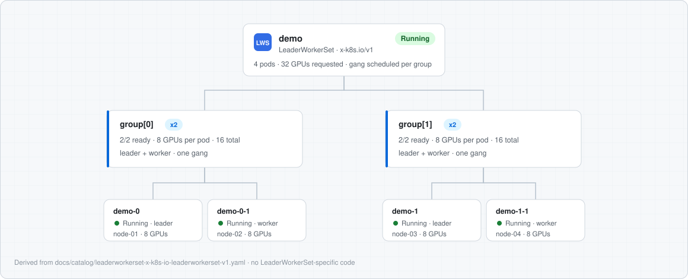

# Workload Map (formerly Karta)

**A standard way to describe the structure of any Kubernetes workload type.**

[](https://github.com/dsx-ai-factory/workload-map/actions/workflows/ci.yaml)
[](https://pkg.go.dev/github.com/dsx-ai-factory/workload-map/karta/sdk)
[](https://goreportcard.com/report/github.com/dsx-ai-factory/workload-map)
[](https://github.com/dsx-ai-factory/workload-map/releases)
[](LICENSE)

Workload Map lets you define a portable, declarative blueprint for any Kubernetes workload - whether it's a simple Deployment, a distributed PyTorchJob, or a custom CRD. Controllers and platforms can then use that blueprint to inspect, modify, and manage workloads without hard-coding knowledge of each type.

> **Repository move and rename notice:** On September 10, 2026, this repository
> moved from the run-ai GitHub organization to
> `dsx-ai-factory/karta`. On September 15, 2026, the project was renamed from
> Karta to Workload Map to align with DSX OS naming conventions, and the
> repository moved again to
> [`dsx-ai-factory/workload-map`](https://github.com/dsx-ai-factory/workload-map).
> Existing repository URLs and standard Git operations continue to work through
> GitHub redirects. The Go module path has also moved to
> `github.com/dsx-ai-factory/workload-map`; update any pinned `go get` or import
> paths, GitHub Actions, webhooks, or other automation that reference
> `run-ai/karta` or `dsx-ai-factory/karta`. After v0.2.x the library moves again,
> into the nested module `github.com/dsx-ai-factory/workload-map/karta/sdk`.

| Name | What it is |
|---|---|
| Workload Map | The project, formerly called Karta. The repository is `workload-map` |
| `Karta` | The CRD kind and the name of its definitions |
| `kli` | The CLI |
| `github.com/dsx-ai-factory/workload-map/karta/sdk` | The Go library module |

## Why Workload Map Exists

In Kubernetes, and especially in AI systems, a workload is not a standalone execution unit such as a single pod. A workload is composed of multiple components organized in a hierarchy of resources. These resources are often exposed through custom resource definitions (CRDs) such as PyTorchJob, RayCluster, and MPIJob. Each CRD structures the workload configuration differently, but all of them share the same building blocks: pod specifications, scaling parameters, and status definitions.

If you build a controller, scheduler, or platform that works with more than one workload type, you write custom logic for each type to answer the same questions:

- Where is the pod template?
- How do I find the replica count?
- Which status conditions mean running and which mean failed?
- How do I modify the pod spec without breaking the workload?

This approach does not scale. Every new workload type needs new integration code. Each scheduler, controller, and platform maintains its own adapters that implement the same patterns.

## What Workload Map Does

Workload Map maps the structure of any workload type into a standard schema. A definition uses JQ-based path expressions to declare where to find the pod specifications, scaling parameters, and status fields in a workload hierarchy. After you define a workload type once, any controller can use the definition to:

- Extract pod templates, replica counts, status, and metadata.
- Update pod specs, labels, and annotations across all instances.
- Understand the workload hierarchy, such as a JobSet with leader and worker groups.

Workload Map provides the following:

- The `Karta` CRD, which defines the structure of a workload type.
- A Go library that evaluates the path expressions to interpret custom resource schemas. The library traverses the workload hierarchy to identify and group pods. It also applies optimization instructions such as gang scheduling, which places the pods of a distributed workload together.
- A [catalog](docs/catalog/) of pre-built and tested definitions for common workload types, including JobSet, PyTorchJob, RayCluster, MPIJob, LeaderWorkerSet, KServe InferenceService, NVIDIA NIM, NVIDIA Dynamo, and Grove PodCliqueSet.
- The `kli` command-line tool, which inspects workloads through their definitions.

```
┌──────────────────────────────────────────────────┐
│                   Your Platform                  │
│  (scheduler, controller, dashboard, CLI, etc.)   │
├──────────────────────────────────────────────────┤
│            Workload Map Component API            │
│    Extract pods · Update specs · Read status     │
├────────────┬────────────┬────────────┬───────────┤
│ Definition │ Definition │ Definition │ Definition│
│ JobSet     │ RayCluster │ PyTorchJob │ YourCRD   │
└────────────┴────────────┴────────────┴───────────┘
```



A LeaderWorkerSet resolved into a uniform tree: groups, roles, GPU counts, and status, all read from its definition.

## Usage

### Try the offline quickstart

See the uniform API read and mutate a JobSet and a LeaderWorkerSet. You need Go 1.27.3 or later and no cluster. Follow [Quickstart - Go Library](docs/getting-started/quickstarts/quickstart-go-library.md). The example code is in [`docs/examples/quickstart/`](docs/examples/quickstart/), and its README shows the full expected output.

### Use the Go library

Call Workload Map from your own controller or tool. You need Go 1.27.3 or later.

```bash
go get github.com/dsx-ai-factory/workload-map/karta/sdk@latest
```

Read the pods, the scale, and the status of a workload through its definition:

```go
import "github.com/dsx-ai-factory/workload-map/karta/sdk/pkg/resource"

// Create a factory from your definition and workload object
factory := resource.NewComponentFactoryFromObject(karta, jobSetObject)

// Get the child component which has the per-instance data
component, _ := factory.GetComponent("replicatedjob")
summaries, _ := component.GetExtractedInstances(ctx)

// Get status from the root component
rootComponent, _ := factory.GetRootComponent()
status, _ := rootComponent.GetStatus(ctx)
```

For the module path change and the import paths, refer to [Installation](docs/getting-started/installation.md#install-the-go-library). To write code against the library, refer to [Use the Go Library](docs/building-on-workload-map/build-a-controller/use-the-go-library.md).

### Install the CLI

Inspect workloads with `kli`. You need Homebrew or a release archive. Inspecting live workloads also needs a cluster and a `kubectl` context.

```bash
brew tap dsx-ai-factory/kli https://github.com/dsx-ai-factory/workload-map
brew install dsx-ai-factory/kli/kli
```

Installing by full name makes Homebrew trust this one cask, which it requires for any tap it does not maintain. To install without Homebrew, download the archive for your platform from the [GitHub Releases page](https://github.com/dsx-ai-factory/workload-map/releases).

For all the options, refer to [Installation](docs/getting-started/installation.md#install-the-kli-cli). To start using the CLI, refer to [Quickstart - CLI](docs/getting-started/quickstarts/quickstart-cli.md) and [Inspect Workloads with the CLI](docs/observability/inspect-workloads-with-the-cli.md).

### Write your own definition

Describe a workload type, starting with a batch Job, and validate it. You need `kli`, or Go 1.27.3 or later. A definition maps where a workload keeps its status, its pod template, and its replica count. This is the shape of the JobSet definition, shortened:

```yaml
apiVersion: run.ai/v1alpha1
kind: Karta
spec:
  structureDefinition:
    rootComponent:
      name: jobset
      kind:
        group: jobset.x-k8s.io
        version: v1alpha2
        kind: JobSet
      statusDefinition:
        ...
    childComponents:
    - name: replicatedjob
      kind:
        group: batch
        version: v1
        kind: Job
      ownerRef: jobset
      specDefinition:
        podTemplateSpecPath: .spec.replicatedJobs[].template.spec.template
      scaleDefinition:
        replicasPath: .spec.replicatedJobs[] | .replicas * .template.spec.parallelism
      instanceIdPath: .spec.replicatedJobs[].name  # Instances: "master", "worker"
```

The full JobSet definition is in [`docs/catalog/`](docs/catalog/jobset-x-k8s-io-jobset-v1alpha2.yaml). Follow [Tutorial - Write Your First Workload Definition](docs/getting-started/tutorial-write-your-first-workload-definition.md). For the full syntax, refer to the [Workload Definition Spec](docs/reference/workload-definition-spec.md).

### Build a controller

Watch live LeaderWorkerSet workloads, then inspect and mutate them through their definitions with no per-CRD code. Adding more workload types is a flag change, not a rebuild. You need `kind`, `kubectl`, and `docker`, and Go to build the image. Follow [Tutorial - Build a Controller on Kind](docs/building-on-workload-map/build-a-controller/tutorial-build-a-controller-on-kind.md). The controller code is in [`docs/examples/controller-runtime/`](docs/examples/controller-runtime/).

## Pre-built Definitions

Workload Map supports a wide range of workload types. The following are examples of the pre-built and tested definitions that ship with the project:

| Workload Type | Framework |
|---|---|
| JobSet | Kubernetes |
| LeaderWorkerSet | Kubernetes |
| PyTorchJob | Kubeflow |
| MPIJob | Kubeflow |
| RayCluster | Ray |
| InferenceService | KServe |
| NIM Service | NVIDIA |
| DynamoGraphDeployment | NVIDIA Dynamo |

For the full list, refer to the [Catalog of Definitions](docs/reference/catalog-of-definitions.md). The definitions themselves are in the [`docs/catalog/`](docs/catalog/) folder. Run `kli definitions` to list the definitions the CLI ships with.

### Complex example: NVIDIA Dynamo

The [Dynamo definition](docs/catalog/nvidia-com-dynamographdeployment-v1alpha1.yaml) shows Workload Map handling a real-world multi-service inference graph - fragmented pod specs across services, autoscaling with min/max replicas, replica selectors for multi-node workers, gang scheduling, and 6 additional child resource types (DynamoComponentDeployment, LeaderWorkerSet, PodGang, PodClique, PodCliqueSet, PodCliqueScalingGroup). A single definition replaces what would otherwise require hundreds of lines of per-type controller logic.

## Who Uses Workload Map?

Workload Map was created at [Run:ai](https://run.ai) (NVIDIA) to power workload management across diverse Kubernetes workload types. It is used internally by multiple services including the workload controllers, scheduler integrations, and platform components.

[KAI Scheduler](https://github.com/kai-scheduler/KAI-Scheduler), a CNCF sandbox open-source Kubernetes scheduler for AI and GPU workloads, uses Workload Map as the generic fallback plugin in its pod grouper ([kai-scheduler/KAI-Scheduler#1527](https://github.com/kai-scheduler/KAI-Scheduler/issues/1527)). A Workload Map definition gives any CRD correct pod grouping and gang scheduling in KAI, with no scheduler plugin to write and no KAI release to wait for. The gang instructions in a definition declare a group's pods as one gang, which KAI admits all-or-nothing. Any scheduler with a gang primitive can translate the same instructions. Native in-tree plugins keep precedence; Workload Map handles the long tail.

See [ADOPTERS.md](ADOPTERS.md) for the full list of adopters. If you use Workload Map, add yourself with a pull request.

## Community

Have a question, an idea, or want to show what you built with Workload Map? Join the conversation in [GitHub Discussions](https://github.com/dsx-ai-factory/workload-map/discussions). For bugs and feature requests, [open an issue](https://github.com/dsx-ai-factory/workload-map/issues). Discussions and issues are the channels maintainers monitor; expect an initial response within 5 business days, usually sooner.

New to the project? Introduce yourself in Discussions - what you are building and which workload types you care about. Good entry points are issues labeled [good first issue](https://github.com/dsx-ai-factory/workload-map/issues?q=is%3Aissue+is%3Aopen+label%3A%22good+first+issue%22) and [help wanted](https://github.com/dsx-ai-factory/workload-map/issues?q=is%3Aissue+is%3Aopen+label%3A%22help+wanted%22), and [CONTRIBUTING.md](CONTRIBUTING.md) covers the development workflow end to end.

## Status

Workload Map is in active development (pre-1.0). The API may change between minor versions. See the [Roadmap](ROADMAP.md) for where the project is headed. We welcome feedback and contributions - please [open an issue](https://github.com/dsx-ai-factory/workload-map/issues) or [start a discussion](https://github.com/dsx-ai-factory/workload-map/discussions).

## Third-Party Software

This project includes third-party software components. See the [NOTICE](NOTICE) file for attributions and the [THIRD_PARTY_LICENSES](THIRD_PARTY_LICENSES) file for detailed license information.

## License

Apache License 2.0 - see [LICENSE](LICENSE) for the full text.

Copyright (c) 2026 NVIDIA Corporation.
