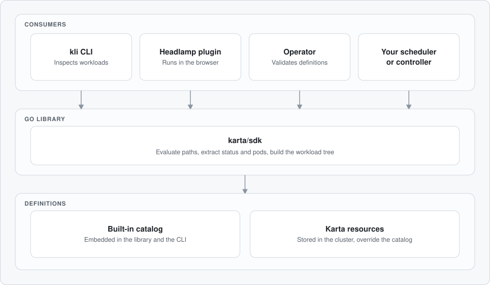

{/* SPDX-License-Identifier: Apache-2.0 */}
{/* Copyright (c) 2026 NVIDIA Corporation */}

Workload Map is designed around a thin, neutral contract. The structure of a workload is described once, in a definition, and every tool reads the same description. The tools do not need to know how each workload type lays out its pods, replicas, and status.

Workload Map is a set of independent components that share the Go library. A definition, stored in the `Karta` CRD or in the built-in catalog, describes a workload type. The library reads a definition and a workload object and produces a uniform view. The CLI, the operator, the Headlamp plugin, and your own controllers consume that view or validate the definitions behind it.

The following diagram shows the layers:

## Components

The following table lists the components of Workload Map.

| Component | Location | Function |
| --- | --- | --- |
| Go library | `karta/sdk/` | Reads a definition and a workload object, extracts pods, scale, status, and specs, and applies updates. The packages cover the API types, the built-in catalog, path evaluation, resource extraction, optimization instructions, and the workload tree. |
| CRD and Helm chart | `charts/karta/` | Provides the `Karta` CRD (`run.ai/v1alpha1`) and the Helm chart that deploys the operator, its webhooks, and a CRD upgrade hook. |
| Operator | `operator/` | Reconciles `Karta` resources. It validates each definition and reports the result in the `Validated`, `CRDExists`, and `Ready` conditions. Its admission webhook labels new definitions and rejects invalid ones. |
| `kli` CLI | `cli/` | Inspects workloads from a terminal. It merges the definitions built into the binary with the definitions in the cluster. |
| WebAssembly engine | `karta-wasm/` | Compiles the library to WebAssembly so that a browser can run it. |
| Headlamp plugin | `headlamp-plugin/` | Shows workloads in Headlamp. It runs the WebAssembly engine in the browser, so no server-side component is needed. |

Every component sits on top of the library. The CLI uses the library directly, and the Headlamp plugin uses it through the WebAssembly engine. The operator uses the library to validate the definitions that it reconciles. The built-in catalog is part of the library and is used by the CLI.

The operator manages definitions only. The CLI and the library do not require the operator, because the CLI reads definitions from its built-in catalog and from the cluster.

## Data Flow

A workload and its definition become a view in the following sequence. The `kli describe` command follows this sequence.

1. Select the definition that covers the workload type. A definition in the cluster overrides the built-in catalog definition for the same workload type.
2. Read the workload object and its pods from the cluster, or read a manifest that you have not yet submitted.
3. Evaluate the path expressions in the definition to extract the components, instances, scale, and status.
4. Build the workload tree. Pods are attributed to the component whose role they play, by ownership and by the pod selectors in the definition.
5. Render or act on the tree. The CLI and the Headlamp plugin render it, a scheduler reads the gang scheduling instructions, and a controller updates the pod specs.

## Deployment Topologies

The following table shows where each part of Workload Map runs.

| Part | Where it runs | Requirements |
| --- | --- | --- |
| Go library | Inside the process of the consumer, such as a scheduler or controller | None |
| `kli` CLI | On your workstation | A kubeconfig for live workloads. No cluster for a manifest that you have not yet submitted. |
| Operator | In the cluster, as a Deployment from the Helm chart | Permission to create the CRD, cluster roles, and webhook configurations |
| Headlamp plugin | In the browser, inside Headlamp | Access to the cluster through Headlamp |

## Related Topics

- [What is Workload Map?](what-is-workload-map.mdx)
- [Key Features of Workload Map](key-features.mdx)
