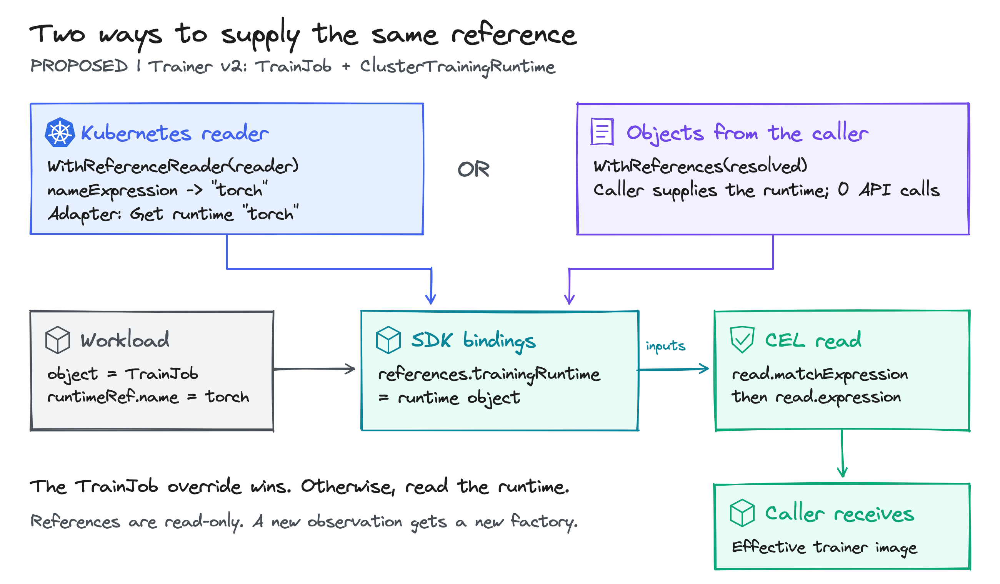

<!-- SPDX-License-Identifier: Apache-2.0 -->
<!-- Copyright (c) 2026 NVIDIA Corporation -->

<a id="implementation-evidence"></a>

# CEL and references: SDK implementation design

[KEP-0002](../../keps/0002-cel-expressions/README.md) separates CEL reads from write locations in a Karta definition.  
The SDK reads and changes workloads through those rules. The application saves changes to Kubernetes.  
These examples describe the proposed `v1alpha2` SDK. They cannot compile against current upstream, which still uses jq.  
Karta definitions use `*kartav1alpha2.Karta`; decoded workloads use `*unstructured.Unstructured`.

## Validation

The Karta operator's validating webhook checks definitions on create and update.  
The same validator is available to SDK callers:

```go
if err := kartav1alpha2.NewKartaValidator(kserveKarta).Validate(); err != nil {
    return err
}
```

Validation checks field shapes, compiles CEL and rejects unavailable inputs. A valid definition returns no error.

| Invalid definition | Example |
| --- | --- |
| Duplicate variable | Two `spec.variables` entries both use `name: model`. |
| Missing variable | An expression reads `variables.image`, but `image` is not declared. |
| Dependency cycle | `a` reads `variables.b`, and `b` reads `variables.a`. Neither can be evaluated first. |

A fixed `write.path` is a JSON Pointer into the workload, such as `/spec/predictor/model` in an InferenceService.  
The validator checks fixed paths when loading the definition. Paths returned by `write.pathExpression` are checked after evaluation.

## Value accessors

An accessor defines a read, a write, or both:

```go
type ValueAccessor struct {
    Read  *ReadAccessor  `json:"read,omitempty"`
    Write *WriteAccessor `json:"write,omitempty"`
}

type ReadAccessor struct {
    MatchExpression string `json:"matchExpression,omitempty"`
    Expression      string `json:"expression"`
}

type WriteAccessor struct {
    MatchExpression string  `json:"matchExpression,omitempty"`
    Path            *string `json:"path,omitempty"`
    PathExpression  string  `json:"pathExpression,omitempty"`
}
```

Each operation evaluates its match before the read expression or write path. An omitted match means true.  
A false read match returns `resource.ErrValueNotFound`; whole-workload reads skip that field.  
A false write match prevents the change. Type and evaluation errors remain errors.  
An omitted `Path` differs from `path: ""`, which selects the whole workload.

| Expression | Inputs |
| --- | --- |
| Workload read, its match, or a shared variable | Original workload as `object`, plus `variables` and `references` |
| Write path or its match | The same inputs, plus `instance` and `index` |
| Pod selector or grouping expression | One Pod as `object` only |
| Reference lookup or selector | `object` is the workload passed to the SDK, such as a TrainJob. These expressions cannot use `variables` or `references`. |

Callers select an instance by ID. The SDK finds its index in the ordered ID list.  
For IDs `["gpu", "cpu"]`, selecting `"gpu"` gives `instance = "gpu"` and `index = 0`.  
The ID list and component values have the same order. Without named instances, the inputs are `instance = ""` and `index = 0`.  
Write expressions cannot read the caller's new value.

The SDK compiles each definition revision once and reuses the CEL programs.  
Each evaluation has its own workload snapshot and reference inputs, and resolves only the variables it needs.  
The evaluator supports cel-go optional values, strings and list extensions. An explicit null stays null; only a missing optional value takes its default.

CEL receives workload and reference data as plain maps, lists and values.  
Results must have the expected type: a boolean for a match or a string for a write path.  
SDK options set the CEL cost limit and evaluation timeout. Evaluation also respects context cancellation.  
Errors identify the component and field without including object contents.

## Writing a value

`Field` names the value to change. Its matching Karta accessor supplies the write rule.  
A field without a writable accessor returns an error.

```go
type Write struct {
    Component string
    Instance  string
    Field     Field
    Value     any
}

type Field string

const (
    PodTemplateSpec Field = "podTemplateSpec"
    PodSpec         Field = "podSpec"
    Container       Field = "container"
)
```

For KServe, `Container` selects `fragmentedPodSpecDefinition.container`.  
Definitions that map a complete PodSpec or PodTemplateSpec use the corresponding selector.  
This call updates the model image in the KEP's InferenceService:

```go
editor, err := tree.Open(ctx, kserveKarta, inferenceService)
if err != nil {
    return err
}
if err := editor.Mutate(ctx, tree.Write{
    Component: "predictor",
    Field:     tree.Container,
    Value:     map[string]any{"image": "ghcr.io/example/inference:v2"},
}); err != nil {
    return err
}
updated, err := editor.GetResource()
if err != nil {
    return err
}
return k8sClient.Update(ctx, updated)
```

The image becomes `ghcr.io/example/inference:v2`; `storageUri` and other unspecified fields stay unchanged.  
The editor changes a copy; `k8sClient.Update` saves it to Kubernetes.  
Update errors return to the application. After a resource-version conflict, it fetches the workload again and opens a new editor.

`Mutate(ctx, writes...)` applies one batch atomically. A later call starts from the last successful batch.  
It resolves all matches and destinations against the starting workload.  
Missing write rules, false matches, invalid pointers, duplicate or overlapping targets, and unknown or duplicate instance IDs all fail before mutation.  
It then applies each JSON Merge Patch to a private copy. Missing object parents are created, but paths through scalars or missing array entries fail.  
Finally, it checks workload identity and extracts the tree again with a new factory. The updated object and tree become available together only if every operation succeeds.

`Write.Value` accepts non-null JSON values. Maps merge, scalars and arrays replace, and null map values delete keys.  
Changing a container list therefore requires the full array. Merge Patch cannot merge containers by name or store a literal null in a map.  
The initial API supports only Merge Patch. Raw JSON writes replace typed `Component.Update*` methods in v1alpha2 so operator-specific fields can be preserved.

## Reading a value

This read uses the KEP's original InferenceService, with image `ghcr.io/example/inference:v1`.  
Its predictor component exposes the mapped container through a typed getter:

```go
factory := resource.NewComponentFactoryFromObject(kserveKarta, inferenceService)
predictor, err := factory.GetComponent("predictor")
if err != nil {
    return err
}
podSpecFragments, err := predictor.GetFragmentedPodSpec(ctx)
if err != nil {
    return err
}
fmt.Println(podSpecFragments[""].Container.Image)
```

The result is `ghcr.io/example/inference:v1`. The empty key identifies the single unnamed instance.  
CEL evaluates the mapping against the whole InferenceService as `object`; the getter converts the result to a container value.  
Typed reads omit operator-specific fields such as `storageUri`. Their results therefore cannot replace the original object in a write.

## Tree traversal

The [LeaderWorkerSet example](../../examples/quickstart/lws.yaml) has a `group` component with `leader` and `worker` children.  
`lwsKarta` is its catalog definition converted to CEL; `leaderWorkerSet` is the example decoded as an unstructured object:

```go
factory := resource.NewComponentFactoryFromObject(lwsKarta, leaderWorkerSet)
workload, err := tree.Build(ctx, factory)
if err != nil {
    return err
}
var visit func([]tree.ComponentNode)
visit = func(nodes []tree.ComponentNode) {
    for _, component := range nodes {
        fmt.Println(component.Name)
        for _, instance := range component.Instances {
            visit(instance.Children)
        }
    }
}
visit(workload.Children)
```

The local `visit` function prints `group`, `leader`, then `worker`.  
`tree.Build` validates the definition and extracts component values. Its `Children` excludes the root, which is available through `factory.GetRootComponent()`.  
The tree describes component structure. Replica counts remain values rather than expanding into generated replicas.

## Pod mapping

For a Pod already associated with an InferenceService, the SDK identifies its component.  
Here, `pod` is a `*corev1.Pod` with labels `component: predictor` and `serving.kserve.io/inferenceservice: model`:

```go
summary, err := instructions.NewStructureSummary(kserveKarta)
if err != nil {
    return err
}
querier := resource.NewPodQuerier(pod)
component, err := instructions.InferPodComponent(ctx, querier, summary)
if err != nil {
    return err
}
fmt.Println(component)
```

The result is `predictor`. Pod selectors evaluate against the Pod as `object`.  
With the InferenceService factory from the read example, `instructions.InferPodComponentInstance(ctx, querier, component, factory)` returns its instance ID as a `*string`.  
This predictor has one unnamed instance, so the result is nil.

## Scheduling groups

The same Pod, component and summary identify its scheduling group and keys:

```go
group, err := instructions.GetPodGroupingEffectiveComponent(
    ctx, querier, component, summary)
if err != nil {
    return err
}
if group == nil {
    return nil
}
keys, err := querier.ExtractGroupKeysFor(ctx, *group.MemberDefinition)
if err != nil {
    return err
}
fmt.Println(group.PodGroupName, keys)
```

For the KEP's KServe definition, the result is `service [model]`. A transformer Pod for the same InferenceService has the same group and key.  
`ExtractGroupKeysFor` evaluates that member's CEL `groupByExpressions` against the Pod.  
The application collects Pods with the same workload identity, group name and ordered keys. The consuming scheduler admits each group as a gang.  
Pod collection, scheduler PodGroup resources and scheduling remain outside the SDK.

## References

Trainer v2 reads an image from the TrainJob override or its referenced ClusterTrainingRuntime.  
The application supplies a reader that can fetch the declared reference or passes the runtime object directly.



### Kubernetes reader

`ResourceReader` provides lookups and lists without requiring a Kubernetes client in the core SDK:

```go
type ResourceReader interface {
    Get(ctx context.Context, gvk schema.GroupVersionKind,
        namespace, name string) (*unstructured.Unstructured, error)
    List(ctx context.Context, gvk schema.GroupVersionKind,
        query ListQuery) ([]unstructured.Unstructured, error)
}

type ListQuery struct {
    Namespace string
    Selector  labels.Selector
}
```

`schema.GroupVersionKind` identifies the Kubernetes type.  
The controller-runtime adapter uses the application's reader and REST mapper:

```go
reader := ctrlreader.New(mgr.GetAPIReader(), mgr.GetRESTMapper())
factory := resource.NewComponentFactoryFromObject(trainJobKarta, trainJob,
    resource.WithReferenceReader(reader))
root, err := factory.GetRootComponent()
if err != nil {
    return err
}
podSpecFragments, err := root.GetFragmentedPodSpec(ctx)
if err != nil {
    return err
}
fmt.Println(podSpecFragments[""].Image)
```

For the KEP's TrainJob and runtime, the result is `ghcr.io/example/trainer:v1`.  
The lookup expression reads the runtime name `torch` from the TrainJob.  
The adapter sets the object or list GVK and calls `Get` for a lookup or `List` for a label selector.  
These Go client calls return the complete result or an error; no `kubectl` process runs.

The REST mapper determines resource scope. Cluster-scoped targets use no namespace; namespaced targets use the workload namespace.  
A namespaced target with an empty namespace is an error. Access uses the application's credentials and RBAC permissions.

### Objects supplied by the application

An application that already has the runtime can pass it directly:

```go
resolved := references.ResolvedReferences{
    "trainingRuntime": references.NewLookupValue(runtimeObject),
}
factory := resource.NewComponentFactoryFromObject(trainJobKarta, trainJob,
    resource.WithReferences(resolved))
```

`runtimeObject` is the KEP runtime as an `*unstructured.Unstructured`. Each reference holds a lookup result or list:

```go
type ResolvedReferences map[string]ReferenceValue

type ReferenceValue struct {
    Object *unstructured.Unstructured
    List   []unstructured.Unstructured
}
```

At most one field is set. `NewLookupValue(nil)` records a missing object; `NewListValue(nil)` creates a non-nil empty list.  
The SDK copies the values, and the image getter returns the same result without client calls.

Supplied objects must follow the declaration's name, kind and namespace rules.  
The SDK checks names and binding shape without fetching objects to verify selection. Supplying both values and a reader is an error.  
Lookup-recipe tests use an in-memory `ResourceReader` over recorded objects.

### Deployment status with or without Pod references

The input is a Deployment named `web` in `team-a`, with two replicas and selector `app: web`.  
The selector below matches that Deployment's full selector and lists Pods in its namespace.

```yaml
# Under spec.structureDefinition in deploymentKarta.
references:
  - name: pods
    apiVersion: v1
    kind: Pod
    list:
      matchLabels:
        app:
          expression: object.spec.selector.matchLabels.app
rootComponent:
  name: deployment
  kind: {group: apps, version: v1, kind: Deployment}
  statusDefinition:
    statusMappings:
      running:
        - byExpression:
            expression: >-
              object.spec.replicas > 0 &&
              object.?status.?observedGeneration.orValue(0) >= object.metadata.generation &&
              object.?status.?updatedReplicas.orValue(0) == object.spec.replicas &&
              ("pods" in references ?
                references.pods.size() == object.spec.replicas &&
                references.pods.all(p,
                  p.?metadata.?deletionTimestamp.orValue(null) == null &&
                  p.?status.?phase.orValue("") == "Running" &&
                  p.?status.?conditions.orValue([]).exists(c,
                    c.type == "Ready" && c.status == "True")) :
                object.?status.?conditions.orValue([]).exists(c,
                  c.type == "Available" && c.status == "True"))
```

`object` is the Deployment. The generation check compares its own `observedGeneration` and `metadata.generation`; Pod generations are unrelated.  
With Pod references, the rule also requires the desired number of Pods, all Running, Ready and not terminating.  
Without them, it uses the Deployment's `Available` condition. A successful empty Pod list does not use that fallback.

The proposed Go option chooses whether this factory uses references:

```go
withPods := resource.NewComponentFactoryFromObject(deploymentKarta, deployment,
    resource.WithReferencesEnabled(true),
    resource.WithReferenceReader(reader))

statusOnly := resource.NewComponentFactoryFromObject(deploymentKarta, deployment,
    resource.WithReferencesEnabled(false))
```

`WithReferencesEnabled` defaults to true and is also accepted by `tree.Open`. False prevents reference reads and exposes an empty `references` map, even if values were supplied.  
The CEL expression defines the fallback; the SDK does not choose a workload status on its own. A definition that accesses a missing reference without a fallback still fails.  
When enabled, reference read errors remain errors. This option does not add a CRD field.

Both factories use the same status getter:

```go
root, err := withPods.GetRootComponent()
if err != nil {
    return err
}
status, err := root.GetStatus(ctx)
if err != nil {
    return err
}
fmt.Println(status.MatchedStatuses)
```

For two Ready Pods in the current rollout, `withPods` returns `[Running]`.  
Using `statusOnly` requires the same generation and updated-replica checks plus `Available=True`, without listing Pods.  
The result is a computed Karta status; neither call writes the Deployment's Kubernetes `.status`.

### Resolution and lifetime

Each reference has a unique name and declares one lookup or list. Lookups require a nonempty name.  
Lists accept `matchLabels` and `matchExpressions`, with literal `value` or CEL `expression` entries. Results are sorted by namespace and name.  
Lookup and selector expressions only see the original workload, so references cannot form chains.

Reads without reference dependencies make no fetches.  
With references enabled, the first dependent read resolves all declared references and keeps successful results. Failed resolutions are not cached.  
Dependencies come from expression syntax, so Trainer's fallback resolves its runtime even when the TrainJob has an image override.  
Whole-tree extraction can trigger resolution immediately. Component getters allow status-only reads.

For a missing object, the adapter returns `references.ErrNotFound`. The SDK leaves that lookup unbound and continues evaluation.  
A TrainJob image override can still be returned; without an override, reading the missing runtime fails. An empty list binds `[]`.  
Other reader errors, including denied reads, stop evaluation even when an override is present. With references enabled, a dependent read also fails if the factory has no reference source.  
A cache-backed reader is responsible for its setup and freshness; `GetAPIReader` reads the API directly.

Each workload observation gets a new factory, used serially. Its reader results or supplied values expose reference updates and deletions.  
The consuming application owns watches and retries. Reads of several Kubernetes objects do not form an atomic snapshot.

After a mutation, the new factory keeps the reference option. If enabled, it resolves references against the updated workload.  
With references enabled and supplied values, a mutation cannot change a reference's lookup name or selector. Such a change requires an updated input object and a new editor with matching reference values.

## Release verification

Release tests compare status results on existing recordings and check that jq and CEL mutations produce equivalent objects.  
New recordings cover Pod mapping and grouping. Tests also cover match failures, null patch rejection, both reference sources, changed reference recipes, and the KEP's schema and migration cases.  
Source and API changes also require generated-manifest and presubmit checks.
