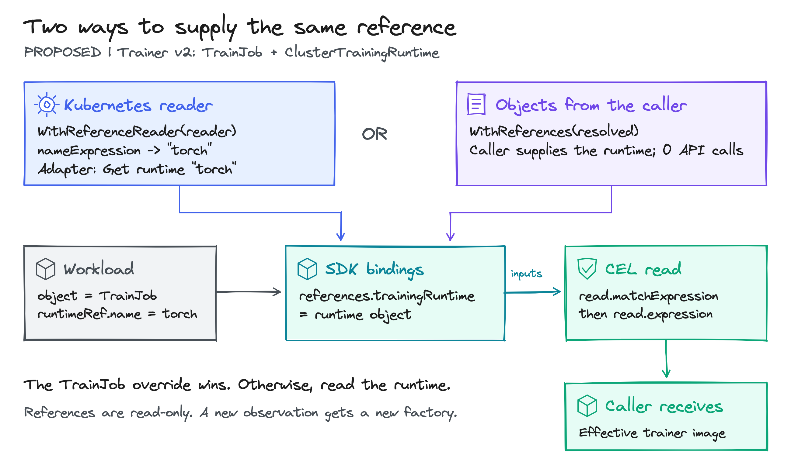

<!-- SPDX-License-Identifier: Apache-2.0 -->
<!-- Copyright (c) 2026 NVIDIA Corporation -->

# CEL and references: SDK implementation design

[KEP-0002](../../keps/0002-cel-expressions/README.md) defines the CRD and the
KServe and Trainer examples. This design describes the proposed SDK changes.
The current upstream SDK still uses jq. The API sketches below are not available
in an upstream release.

## Read and write execution



For KServe, the caller asks to change the predictor's image. The SDK evaluates
the write match, resolves `/spec/predictor/model`, and merges the supplied image
into that object. It returns an updated InferenceService. The caller decides
when to send that object to Kubernetes.

The versioned API uses these types. Pointer fields distinguish an omitted path
from `path: ""`, which selects the whole workload:

```go
type ValueAccessor struct {
    Read  *ReadAccessor  `json:"read,omitempty"`
    Write *WriteAccessor `json:"write,omitempty"`
}

type ReadAccessor struct {
    MatchExpression string `json:"matchExpression,omitempty"`
    Expression      string `json:"expression"`
}

type WriteAccessor struct {
    MatchExpression string  `json:"matchExpression,omitempty"`
    Path            *string `json:"path,omitempty"`
    PathExpression  string  `json:"pathExpression,omitempty"`
}
```

Admission validates the field shape and compiles CEL. A fixed pointer must be
valid; a computed pointer is checked after evaluation. Reject duplicate variable
names, unknown dependencies and dependency cycles. Loaders for local YAML
run the same validation. Compile programs once per definition revision and reuse
them. Keep workload values and reference bindings outside the compiled program.

Each operation evaluates its match before its value or path. Resolve only the
workload variables needed by that operation, against its workload snapshot.

| Expression | Inputs |
| --- | --- |
| Workload read, its match, or a shared variable | Root workload as `object`, `variables`, `references` |
| Write path or its match | The same workload inputs, plus `instance` and `index` |
| Pod selector or grouping expression | One Pod as `object` only |
| Reference lookup or selector recipe | Root workload as `object` only |

Admission rejects unavailable bindings, including `variables` or `references`
in Pod expressions. Write expressions never receive the caller's new value.
`instance` is the selected string ID; `index` is its zero-based CEL integer
position in `instanceIds.read.expression`. The ID list and component read values
must have the same order. For IDs `["gpu", "cpu"]`, requesting `"gpu"` gives
`instance = "gpu"` and `index = 0`. A component without named instances receives
`instance = ""` and `index = 0`. The caller supplies the ID, never the index.

Use cel-go optional values, strings and list extensions for the KEP examples.
A missing optional lookup can supply a default. An explicit null remains null;
it is not automatically the same as a missing field. Normalize inputs to JSON
values, check output types, and apply an evaluation cost limit plus context
cancellation. Errors identify the component and field without object contents.

## Applying a change

The public write call carries the logical field and a JSON Merge Patch value:

```go
type Write struct {
    Component string
    Instance  string
    Field     Field
    Value     any
}

type Field string

const Container Field = "fragmented.container"
```

For the KEP's InferenceService, the proposed call is:

```go
editor, err := tree.Open(ctx, kserveKarta, inferenceService)
if err != nil {
    return err
}
if err := editor.Mutate(ctx, tree.Write{
    Component: "predictor",
    Field:     tree.Container,
    Value:     map[string]any{"image": "ghcr.io/example/inference:v2"},
}); err != nil {
    return err
}
updated, err := editor.GetResource()
if err != nil {
    return err
}
return k8sClient.Update(ctx, updated)
```

Here `k8sClient` is the caller's controller-runtime client. The editor works on
a copy. It does not call the client. The selected model keeps `storageUri` and
any other keys that the patch does not mention. If Kubernetes rejects the update,
the caller handles the error. On a resource-version conflict, fetch the workload
again and recalculate the change using a new editor.

`Mutate` follows this order:

1. Resolve all write matches and destinations against the starting workload.
   Reject absent write definitions, false matches, invalid pointers, duplicate
   or overlapping targets, and unknown or duplicate instance IDs.
2. Apply each merge patch at its selected subtree in a private copy. Create
   missing object parents; never invent array entries or replace a scalar parent.
3. Validate workload identity and re-extract the tree through a new factory.
   Publish the new object and tree together only if every operation succeeds.

The new factory uses the updated workload to resolve references. With manual
bindings, reject a mutation that changes a reference lookup name or selector
values. Change that reference on the input object and open a new editor with
matching bindings.

`Write.Value` must be a non-null JSON value. Merge Patch merges map keys, replaces
scalars and arrays, and deletes a map key when its patch value is null. It cannot
store literal null in a map or merge containers by name. A caller editing an
array supplies the complete new array.
There is no patch-format setting in the CRD or initial public SDK.

The SDK release that adds v1alpha2 removes the typed `Component.Update*` writers.
Callers migrate to raw JSON `Mutate` calls; typed reads remain. Serializing a `corev1.Container`
loses operator-specific fields. Raw JSON lets callers state only the fields
they intend to change.

## References with a Kubernetes client

The SDK owns reference resolution. A replaceable reader owns fetching:

```go
type ResourceReader interface {
    Get(ctx context.Context, gvk schema.GroupVersionKind,
        namespace, name string) (*unstructured.Unstructured, error)
    List(ctx context.Context, gvk schema.GroupVersionKind,
        query ListQuery) ([]unstructured.Unstructured, error)
}

type ListQuery struct {
    Namespace string
    Selector  labels.Selector
}
```

`schema.GroupVersionKind` identifies the Kubernetes type. The objects use
Kubernetes `unstructured` types; the core SDK needs no Kubernetes client.
A separate controller-runtime adapter receives the reader the consumer already
uses, plus its REST mapper for resource scope:

```go
reader := ctrlreader.New(mgr.GetAPIReader(), mgr.GetRESTMapper())
factory := resource.NewComponentFactoryFromObject(trainJobKarta, trainJob,
    resource.WithReferenceReader(reader))
root, err := factory.GetRootComponent()
if err != nil {
    return err
}
parts, err := root.GetFragmentedPodSpec(ctx)
if err != nil {
    return err
}
fmt.Println(parts[""].Image)
```

The empty map key identifies a component with one unnamed instance. For the
KEP input, this prints `ghcr.io/example/trainer:v1`. The calls are ordinary Go
client calls; no `kubectl` process runs.

Resolution is lazy at the factory level. A status read whose expressions and
variables do not mention references performs zero fetches. The first dependent
read resolves all declared references:

1. Evaluate each declaration's name or selector values against the TrainJob.
   For `trainingRuntime`, the name is `torch`.
2. Ask the reader for that kind and name. The adapter uses the REST mapper to
   determine scope. It passes an empty namespace for ClusterTrainingRuntime;
   a namespaced kind uses the workload namespace and rejects an empty namespace.
3. For a lookup, set the object's GVK and call `client.Reader.Get`. For a list,
   set the corresponding list GVK and call `List` with the namespace and label
   selector. Return the complete result or an error.
4. Bind the returned object's content as `references.trainingRuntime`, then
   evaluate the image expression and decode its result.

The caller's credentials and RBAC apply. Map a not-found response to
`references.ErrNotFound`. Preserve other errors, including forbidden responses;
never convert a denied read into an absent reference. `GetAPIReader` performs
direct API reads. Consumers choosing a cache-backed reader own its setup and
freshness.

The factory keeps successful results. A failed resolution is not cached.
Dependency checks use expression syntax. Trainer's fallback mentions the runtime
even when an image override is present, so that read still resolves it.

`tree.Open` extracts the whole tree, so it can resolve references immediately.
Use component getters for status-only reads.

## References supplied manually

A caller that already has the runtime can bind it directly:

```go
resolved := references.ResolvedReferences{
    "trainingRuntime": references.NewLookupValue(runtimeObject),
}
factory := resource.NewComponentFactoryFromObject(trainJobKarta, trainJob,
    resource.WithReferences(resolved))
```

`runtimeObject` is an `*unstructured.Unstructured` containing the runtime shown
in the KEP. The named values have this shape; only one member may be set:

```go
type ResolvedReferences map[string]ReferenceValue

type ReferenceValue struct {
    Object *unstructured.Unstructured
    List   []unstructured.Unstructured
}
```

`NewLookupValue(nil)` records a miss. `NewListValue(nil)` creates a non-nil empty
list, so a list miss binds `[]` instead of looking like a lookup miss. The SDK
copies the supplied values. No client call occurs; the image result is identical.

The caller must supply the object selected by the declaration's name, kind and
namespace rules. The SDK checks the binding shape and declared reference name,
but performs no lookup to verify that selection. Test lookup recipes with an in-memory
`ResourceReader` over recorded objects instead. Supplying both a reader and
resolved values is an error.

Reference declarations use unique names and exactly one lookup or list.
Lookup recipes must return a nonempty string. Lists use Kubernetes
`matchLabels` and `matchExpressions`; each label value is either a literal
`value` or a CEL `expression`. Recipes see only `object`, so references cannot
form chains. Sort list results by namespace and name before binding.

A lookup miss leaves its name unbound; optional CEL access can handle it.
An empty list binds `[]`. A dependent read without either reference source
returns an error naming that requirement. Create a new factory for each new
workload observation and serialize access to it. Reference updates or deletion
become visible through a new factory or manual values. Consumers own watches and retry.
An SDK snapshot is not an atomic Kubernetes snapshot across several objects.

## Implementation and verification

Land the versioned API and validation, the CEL evaluator, local mutation, then
reference resolution and the client adapter. Convert catalog definitions with
read/write fixture checks. Test null patch rejection and reference recipes that
change during a mutation, with both reference sources. Keep the scope and version
migration tests required by the KEP in the same release. Run the repository's generated-manifest and
presubmit checks when those implementations change source or API types.

### Implementation evidence

The following are prototype evidence, not tests of this combined proposal:

- [KServe read/write example](https://github.com/AviadHayumi/workload-map/blob/3e5a302084d606422293cc8e2c022c088b790ba6/pkg/tree/example_editable_test.go):
  dynamic `model` and `sklearn` destinations; image updates preserve `storageUri`.
- [Trainer unit tests](https://github.com/AviadHayumi/workload-map/blob/cd91d670a9b6613e4d1c21e066b37a8446eb9fb1/pkg/catalog/trainjob_references_test.go):
  runtime fallback, override precedence, and selection past initializers/sidecars.
- [Trainer live test](https://github.com/AviadHayumi/workload-map/blob/cd91d670a9b6613e4d1c21e066b37a8446eb9fb1/test/e2e/flows/references_live_test.go)
  and [recordings](https://github.com/AviadHayumi/workload-map/tree/cd91d670a9b6613e4d1c21e066b37a8446eb9fb1/test/e2e/recorded_data/trainer/v1.34.0/trainer-kubeflow-org-trainjob-v1alpha1):
  effective runtime values, zero reference reads for status, and suspend/resume.

The new `read`/`write` shape, mutation rules, independent matches, binding validation,
adapter and `v1alpha2` migration remain proposed. The Go snippets describe that proposed API
and cannot compile against current upstream. Tests must prove those contracts
before the implementation is described as complete.
