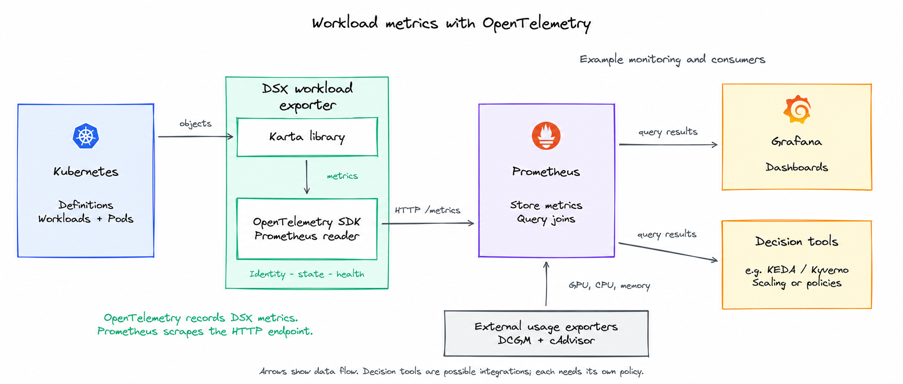

<!-- SPDX-License-Identifier: Apache-2.0 -->
<!-- Copyright (c) 2026 NVIDIA Corporation -->

# KEP-0001: DSX workload exporter

- Status: provisional
- Authors: @AviadHayumi
- Issue: https://github.com/dsx-ai-factory/workload-map/issues/343
- Created: 2026-10-12
- Last updated: 2026-11-03

## Summary

The DSX workload exporter has two main goals:

1. Show the status of selected workloads, such as `Running`, `Failed`, `Degraded`, `Completed` or `Suspended`.
2. Show where each Pod belongs: its workload, component, named instance and repeated group. For example, a Pod in JobSet `train` can belong to component `replicatedjob`, instance `worker` and group `0`.

The exporter provides this identity alongside workload status. Prometheus joins
it with CPU, memory and GPU measurements from other exporters.



Arrows show data flow. Prometheus pulls `/metrics`; native OTLP push is not
supported by the exporter.

## Motivation

A workload average can hide a busy component or group. Karta makes these
relationships queryable without per-operator PromQL.

Examples:

- Dynamo: find quiet prefill GPUs while decode stays busy; check demand before changing capacity.
- LWS: find a quiet worker group hidden by the workload average.
- Workload state: see Running, Failed or Degraded workloads and their observed history.

See [queries](../../dsx-workload-exporter/queries.md) for CPU, memory and GPU
joins, and [configuration](../../dsx-workload-exporter/configuration.md) for
Helm, selection and metric delivery.
See the [implementation design](../../design/metrics-exporter/README.md) for
runtime ownership and verification.

## Metrics

| Metric                                 | Prometheus type | Value                                           | Why it is needed                                                                 |
| -------------------------------------- | --------------- | ----------------------------------------------- | -------------------------------------------------------------------------------- |
| `dsx_workload_pod_info`            | Gauge           | Always `1`                                    | Attach workload, component and group identity to measurements from a Pod.        |
| `dsx_workload_status`              | Gauge           | `1` for a matching phase, otherwise `0`     | Distinguish running, completed or failed work, including workloads with no Pods. |
| `dsx_workload_created_timestamp_seconds` | Gauge | Root `metadata.creationTimestamp` in Unix seconds. | Calculate workload age. |
| `dsx_exporter_observation_valid` | Gauge | Resource-type collection: `1` or `0`. Workload/discovery failures: `0` only. | Report collection health and failure reasons. Healthy workloads have no separate health row. |

Without a selected Karta definition, a verified root still supplies Pod identity,
creation time and all nine status phase gauges with value `0`. The status labels
`karta` and `karta_source` are empty. Zero means no phase matched; it does not
assert an evaluated application state. Workload label rules still apply.
Component and instance are `<unknown>`; group is empty. Missing a definition
alone is not a verification failure.

Creation time comes from the root object. Missing timestamps or failed
root verification omit the sample. Status evaluation alone does not invalidate
verified creation metadata.

### Metric examples

These examples use one Dynamo workload. Values are illustrative.

```prometheus
dsx_workload_pod_info{namespace="team-a",workload_name="dynamo",workload_group="nvidia.com",workload_version="v1alpha1",workload_kind="DynamoGraphDeployment",workload_uid="cea29a7c-8a8b-4dad-aa48-ef0f7c888a73",owner_resolution="resolved",pod_name="prefill-0",pod_uid="f6610f41-62d8-4111-92a7-05aa776ff926",component="service",component_instance="prefill",replica_group_id="",observation_valid="true"} 1
dsx_workload_status{namespace="team-a",workload_name="dynamo",workload_group="nvidia.com",workload_version="v1alpha1",workload_kind="DynamoGraphDeployment",workload_uid="cea29a7c-8a8b-4dad-aa48-ef0f7c888a73",phase="Running",owner_resolution="resolved",karta="nvidia-com-dynamographdeployment-v1alpha1",karta_source="catalog",observation_valid="true"} 1
dsx_workload_created_timestamp_seconds{namespace="team-a",workload_name="dynamo",workload_uid="cea29a7c-8a8b-4dad-aa48-ef0f7c888a73"} 1792324800
dsx_exporter_observation_valid{scope="resource_type",namespace="team-a",resource_group="nvidia.com",resource_version="v1alpha1",resource_kind="DynamoGraphDeployment",workload_name="",workload_uid="",reason="none"} 1
```

### Labels

| Metric | Built-in labels |
| --- | --- |
| `dsx_workload_pod_info` | `namespace`, `workload_name`, `workload_group`, `workload_version`, `workload_kind`, `workload_uid`, `owner_resolution`, `pod_name`, `pod_uid`, `component`, `component_instance`, `replica_group_id`, `observation_valid` |
| `dsx_workload_status` | `namespace`, `workload_name`, `workload_group`, `workload_version`, `workload_kind`, `workload_uid`, `phase`, `owner_resolution`, `karta`, `karta_source`, `observation_valid` |
| `dsx_workload_created_timestamp_seconds` | `namespace`, `workload_name`, `workload_uid` |
| `dsx_exporter_observation_valid` | `scope`, `namespace`, `resource_group`, `resource_version`, `resource_kind`, `workload_name`, `workload_uid`, `reason` |

| Label | Metrics | Meaning | Example |
| --- | --- | --- | --- |
| `namespace` | Pod info, Status, Created, Health | Namespace associated with the observation. | `team-a` |
| `workload_name` | Pod info, Status, Created, Health | Selected root workload object name. Pod info, Status and Created name the same root. Empty for resource-type health. | `train` |
| `workload_group` | Pod info, Status | API group of the observed workload; empty for the core API. | `jobset.x-k8s.io` |
| `workload_version` | Pod info, Status | API version of the attributed root: the selected definition's GVK, or the verified owner GVK when no definition exists. Not `metadata.resourceVersion`. | `v1alpha2` |
| `workload_kind` | Pod info, Status | Kind in the observed workload GVK. | `JobSet` |
| `workload_uid` | Pod info, Status, Created, Health | Kubernetes UID identifying this workload's lifetime. Empty for resource-type health. | `628cbe4e-f726-4279-a174-0d18e9cd0a28` |
| `pod_name` | Pod info | Attributed Pod's name. | `train-worker-0` |
| `pod_uid` | Pod info | Kubernetes UID identifying this Pod's lifetime. | `596e77f2-50af-40d9-96d5-28ab7c01b4dd` |
| `component` | Pod info | Component name from the selected definition; `<unknown>` if unresolved. | `replicatedjob` |
| `component_instance` | Pod info | Named entry within the component; empty when there are no named instances, or `<unknown>` if unresolved. | `worker` |
| `replica_group_id` | Pod info | Definition-selected key for a repeated group of Pods within the workload/component/instance. Empty when no group applies. It is neither a Pod index nor a replica count. | `0` |
| `phase` | Status | Evaluated workload phase; its series value is `1` when matched and `0` otherwise. | `Running` |
| `owner_resolution` | Pod info, Status | `resolved` after verifying the chain; `ignored_owner` at an intentional boundary; retained records keep their previous resolution on failure. Failure reasons are reported by Health. | `resolved` |
| `observation_valid` | Pod info, Status | `"true"` while the verification required for this observation is valid; `"false"` for a retained cached observation after failure. | `true` |
| `karta` | Status | Name of the selected Karta definition, or empty when none is selected. | `jobset-x-k8s-io-jobset-v1alpha2` |
| `karta_source` | Status | Origin of that definition: `catalog`, `cluster`, or empty when none is selected. | `catalog` |
| `scope` | Health | `resource_type` reports collection health per namespace + GVK, including before object names are known; it does not certify each workload evaluation. `workload` reports failures affecting a known workload. `discovery` groups unresolved-input failures with empty workload identity. No healthy workload or discovery row is emitted. | `workload` |
| `resource_group` | Health | API group being verified. For workload scope, identifies the affected root workload, even when a dependency failed. Empty for the core API. | `jobset.x-k8s.io` |
| `resource_version` | Health | API version being verified, not Kubernetes `metadata.resourceVersion`, using the same scope as `resource_group`. | `v1alpha2` |
| `resource_kind` | Health | API kind being verified, using the same scope as `resource_group`. | `JobSet` |
| `reason` | Health | Bounded failure category. `none` is used only for healthy resource-type collection. Workload rows always carry a failure reason. Detailed errors belong in logs. | `none`, `permission_denied` |

### Reading observation validity

`observation_valid="true"` means saved errors and captured source health report
the observation as valid, even if the workload failed. `false` marks retained
Pod info or status with failed evaluation or dependencies. A scrape alone does
not refresh inputs. See [validity limits](#validity-limits). Each
observation has only one validity value in a snapshot. Deletion or scope exit
removes current series; previously collected history remains.

| `reason` | Meaning |
| --- | --- |
| `permission_denied` | A required Kubernetes read was denied. |
| `api_unavailable` | The API could not be reached or a required source is unavailable. |
| `invalid_definition` | The selected Karta definition is invalid. |
| `evaluation_failed` | Karta attribution/status or configured label evaluation failed. |
| `unresolved_owner` | A required owner is missing or its UID does not match. |
| `none` | Resource-type collection is verified. This is never a healthy workload row. |

Prefer `workload_uid` and `pod_uid` over names when matching metrics, where both
inputs provide them. Names can be reused after deletion.

Examples of component attribution:

| Example                           | `component`     | `component_instance` | `replica_group_id` |
| --------------------------------- | ----------------- | ---------------------- | -------------------- |
| Dynamo prefill, Deployment-backed | `service`       | `prefill`            | empty                |
| JobSet, first worker Job          | `replicatedjob` | `worker`             | `0`                |
| JobSet, second worker Job         | `replicatedjob` | `worker`             | `1`                |
| LWS, leader in group 0            | `leader`        | empty                  | `0`                |
| LWS, worker in group 0            | `worker`        | empty                  | `0`                |
| LWS, worker in group 1            | `worker`        | empty                  | `1`                |

### Validity limits

Validity uses saved operation errors and captured source health. The current Store
has no clock or expiry. Source recovery can restore source-only validity before
reconciliation completes. A successful scrape does not prove retained values were
recalculated against recovered inputs. See the
[Store contract](../../../dsx-workload-exporter/pkg/store/README.md).

## Configured labels

Use `exporter.labelRules` to add labels to Pod info or workload status. A rule
names its target metrics, ordered sources and CEL expression. The evaluator
receives the root workload or the specific Pod as `object`.

```yaml
exporter:
  labelRules:
    - name: team
      metrics: [dsx_workload_pod_info, dsx_workload_status]
      sources: [workload]
      expression: |
        has(object.metadata.labels) && "example.com/team" in object.metadata.labels
          ? object.metadata.labels["example.com/team"] : ""
```

Pod info may read the workload, its Pod, or both in order. Workload status cannot
use a Pod source because there is no single Pod to choose. The first nonempty
value wins within a rule. Later successful rules for the same label replace earlier
values; an empty result does not erase an earlier rule's value. Built-in labels
win in exported metrics.

A label error can retain the previous metric result with
`observation_valid="false"`. With no prior result, that output can be absent.
Other successful labels are not published independently of the failed result.

Runtime saves evaluated labels in Store. Collector reads those saved values.
The exporter does not capture caller identity or mutate Kubernetes objects.
See [label configuration](../../dsx-workload-exporter/configuration.md#configured-labels).

## Who submitted the workload

### Directly apply to Kubernetes

Submitter capture is separate from the exporter and Karta operator. Helm installs
a `MutatingAdmissionPolicy` (MAP) and its binding, which run inside the
Kubernetes API server.

```yaml
admissionPolicies:
  submitter:
    enabled: true
    resources:
      - apiGroups: ["batch"]
        apiVersions: ["v1"]
        resources: ["jobs"]
```

Namespaces opt in with the label `karta.run.ai/capture-submitter=true`.
See [submitter configuration](../../design/metrics-exporter/submitter-capture.md#configuration)
for selectors and API version selection.

When `kubectl apply` creates a workload within capture scope, MAP records the
authenticated caller in `karta.run.ai/submitted-by`, unless the request already
sets it. The caller can be a service account. `annotation` changes the key.
Objects with a controller `ownerReference` are skipped, since their creator is a
controller, not the submitter.

Capture is best effort: policy errors use `failurePolicy: Ignore`, and an
annotation-size check skips values that would exceed the limit. A supplied value
is kept, so the annotation is a hint, not proof of identity.

When a platform creates the workload, the caller is the platform's service
account. Prefer the platform's own user annotation in a label rule's expression.
Read it through
`object.metadata.annotations`, as described in [Configured labels](#configured-labels). See the
[implementation design](../../design/metrics-exporter/submitter-capture.md).

MAP feature versions:

| Policy | Alpha from | Beta from | Stable from |
| --- | --- | --- | --- |
| [MAP](https://github.com/kubernetes/enhancements/issues/3962) | 1.32 | 1.34 | 1.36 |

## History

- 2026-10-12 to 2026-10-19: Defined workload metrics and selection; separated configuration and query examples into linked guides.
- 2026-10-25: Added generic metric labels and defined watches for Pods, selected workload kinds and discovered roots. Intermediate owners use metadata reads and periodic revalidation.
- 2026-10-25: Made submitter capture a best-effort MAP with a configurable annotation; dropped the VAP and UPDATE protection.
- 2026-11-03: Renamed the exporter and metrics to DSX. Updated the architecture image and aligned label, owner-resolution and observation-validity descriptions with the implementation.
