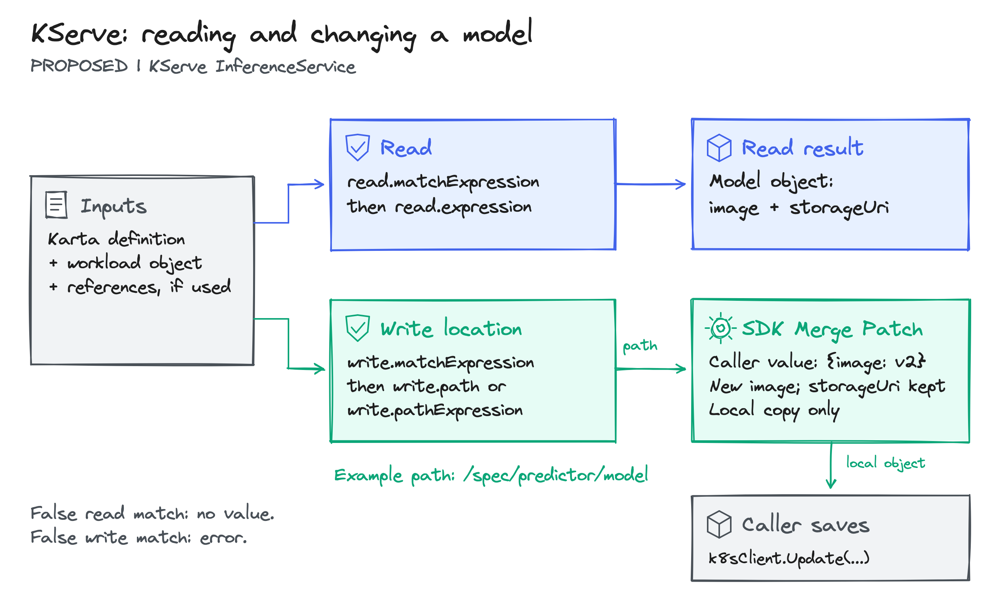

<!-- SPDX-License-Identifier: Apache-2.0 -->
<!-- Copyright (c) 2026 NVIDIA Corporation -->

# KEP-0003: CEL expressions and resource references

- Status: provisional
- Authors: @AviadHayumi
- Issue: https://github.com/dsx-ai-factory/workload-map/issues/330
- Created: 2026-11-15
- Last updated: 2026-11-15

## Summary

Replace jq with [CEL](https://kubernetes.io/docs/reference/using-api/cel/) in Karta definitions. Separate read expressions from write
locations, with an optional match expression on each. Read named references
through a Kubernetes reader or objects supplied by the caller. The SDK changes
the workload locally; the caller saves it to Kubernetes.



## Motivation

KServe can keep a model under `spec.predictor.model` or
`spec.predictor.sklearn`. Its Karta must find the right entry before reading or
changing it. Today one jq path does both jobs. CEL reads values but does not
provide jq assignment, so the write location needs its own definition.

Trainer v2 needs another input. A TrainJob can inherit its image from the
ClusterTrainingRuntime named by `spec.runtimeRef`. Reading only the TrainJob
cannot produce that image.

### Goals

- Use CEL for reads, match expressions and computed write paths.
- Keep new values and patch application in the SDK.
- Read references through the caller's client or supplied objects.

### Non-goals

Policy rules, writes to references, cross-namespace references, and automatic
watches or retries. The [implementation design](../../design/cel-expressions/README.md)
explains the SDK interfaces and execution order.

## Proposal

### KServe: the same operation in jq and CEL

These are the relevant fields of an InferenceService passed to the SDK:

```yaml
apiVersion: serving.kserve.io/v1beta1
kind: InferenceService
metadata: {name: model, namespace: team-a}
spec:
  predictor:
    model:
      image: ghcr.io/example/inference:v1
      storageUri: s3://example-models/model
```

The [current KServe Karta](../../catalog/serving-kserve-io-inferenceservice-v1beta1.yaml)
selects the model with this jq expression:

```jq
.spec.predictor | ( (.[]? | select(type == "object" and .storageUri)))
```

The result is the object containing `image` and `storageUri`. The
[jq runner](../../../karta/sdk/pkg/jq/execution/runner.go) wraps that expression for assignment:

```jq
(.spec.predictor | ( (.[]? | select(type == "object" and .storageUri)))) = $val
```

Here `$val` must contain the entire replacement model. The component writer
uses `AssignZip` to pair selected paths with values. Both forms replace this model.

The proposed Karta separates that read from the write. This excerpt shows its
placement in the CRD; other KServe fields follow the same pattern:

```yaml
apiVersion: run.ai/v1alpha2
kind: Karta
metadata: {name: serving-kserve-io-inferenceservice-v1beta1}
spec:
  variables:
    - name: containerKeys
      expression: >-
        ([dyn(object[?"spec"][?"predictor"].orValue(null))]
          .filter(v, type(v) == map) + [{}])[0]
          .map(k, string(k)).sort().filter(k,
            type(object.spec.predictor[k]) == map &&
            "storageUri" in object.spec.predictor[k] &&
            object.spec.predictor[k]["storageUri"] != null &&
            object.spec.predictor[k]["storageUri"] != false)
  structureDefinition:
    rootComponent:
      name: inferenceservice
      kind: {group: serving.kserve.io, version: v1beta1, kind: InferenceService}
    childComponents:
      - name: predictor
        kind: {group: apps, version: v1, kind: Deployment}
        ownerRef: inferenceservice
        specDefinition:
          fragmentedPodSpecDefinition:
            container:
              read:
                matchExpression: variables.containerKeys.size() > 0
                expression: >-
                  variables.containerKeys.size() == 1 ?
                  object.spec.predictor[variables.containerKeys[0]] :
                  variables.containerKeys.map(k, object.spec.predictor[k])
              write:
                matchExpression: variables.containerKeys.size() == 1
                pathExpression: >-
                  "/spec/predictor/" +
                  variables.containerKeys[0].replace("~", "~0").replace("/", "~1")
```

`object` is the InferenceService, not its Deployment or Pod. `containerKeys`
is `["model"]`. The read returns the model object; the write returns
`/spec/predictor/model`. For a `sklearn` entry, the same definition returns
`/spec/predictor/sklearn`. The two replacements escape a key as a JSON Pointer.

The caller supplies `{image: ghcr.io/example/inference:v2}` as a merge patch at
that location. The result has the new image and the original `storageUri`.
With no model, the read is absent and writing fails. With several models, the
read returns a list that the singular container field rejects; writing fails.
The selection preserves jq's treatment of `storageUri`: null and false do not
match; an empty string does.

### CRD rules

A field has `read`, `write`, or both. `read.expression` returns its value.
`write` has exactly one of `path` or `pathExpression`. A fixed path is a JSON
Pointer ([RFC 6901](https://www.rfc-editor.org/rfc/rfc6901)) such as
`/spec/predictor/schedulerName`; a path expression returns one.
An empty path selects the workload root. Omitting `write` makes a field read-only.

Each side evaluates its own `matchExpression` first. Omission means true.
A false read match returns no value. A false write match returns an error before
changing anything. A match must return a boolean; errors never mean false.
CEL conditional expressions handle alternative reads or locations.

| Current API | Proposed API |
| --- | --- |
| `containerPath`, `podSpecPath`, `replicasPath`, other value paths | `container`, `podSpec`, `replicas`, each with `read` and optional `write` |
| `instanceIdPath` | `instanceIds.read.expression`; read-only |
| Condition `path` and selector `keyPath`/`idPath` | `read.expression` inside the same definition or selector |
| `groupByKeyPaths` | `groupByExpressions`; each expression reads one Pod |
| `byExpression.expression` | CEL boolean; remove `expectedResult` |
| Suspend/resume action `path` and JSON `value` | Action `write` location and the same JSON `value` |
| No shared expressions | `spec.variables[{name, expression}]` |
| No external inputs | `spec.structureDefinition.references` |

Component kinds, ownership and scheduling structure retain their current shape.
Workload reads and shared variables use the root workload as `object`.
Pod selectors and grouping expressions see one Pod as `object`, without shared
variables or references. Reference recipes see only the root workload.

### Trainer v2: read through a reference

These trimmed objects show why a read can need more than the workload:

```yaml
apiVersion: trainer.kubeflow.org/v1alpha1
kind: TrainJob
metadata: {name: train, namespace: team-a}
spec:
  runtimeRef: {name: torch}
---
apiVersion: trainer.kubeflow.org/v1alpha1
kind: ClusterTrainingRuntime
metadata: {name: torch}
spec:
  template:
    spec:
      replicatedJobs:
        - name: node
          template:
            metadata:
              labels: {trainer.kubeflow.org/trainjob-ancestor-step: trainer}
            spec:
              template:
                spec:
                  containers:
                    - {name: node, image: 'ghcr.io/example/trainer:v1'}
```

The Karta declares the lookup and reads the effective image:

```yaml
# Under spec.structureDefinition.
references:
  - name: trainingRuntime
    apiVersion: trainer.kubeflow.org/v1alpha1
    kind: ClusterTrainingRuntime
    lookup:
      nameExpression: object.spec.runtimeRef.name
rootComponent:
  name: trainjob
  kind: {group: trainer.kubeflow.org, version: v1alpha1, kind: TrainJob}
  specDefinition:
    fragmentedPodSpecDefinition:
      image:
        read:
          expression: >-
            object.?spec.?trainer.?image.orValue(
              references.trainingRuntime.spec.template.spec.replicatedJobs
                .filter(j, j.?template.?metadata.?labels
                  ["trainer.kubeflow.org/trainjob-ancestor-step"]
                  .orValue("") == "trainer")[0]
                .template.spec.template.spec.containers
                .filter(c, c[?"name"].orValue("") == "node")[0].image)
```

The read returns `ghcr.io/example/trainer:v1`. Adding
`spec.trainer.image: ghcr.io/example/trainer:v2` makes it return that override.
The runtime lookup uses the trainer label and container name, so an initializer
or sidecar does not become the trainer. This field has no write location.

A reference declares exactly one lookup or label-selector list. A lookup names
one object; a list returns matching objects. Namespaced targets use the workload's
namespace. Cluster-scoped targets have no namespace. Lookup misses stay unbound;
empty lists bind `[]`. Read failures are errors, not missing objects. References
are read-only, whether a reader fetches them or the caller supplies them.

## Compatibility and migration

This is a breaking `run.ai/v1alpha2` schema. There is no automatic jq-to-CEL
conversion and no dual-language switch. Catalog definitions and consumers must
move together. Existing Go consumers that construct versioned API types must
adapt to the new types; mutation callers must use explicit partial values.

For existing installations, export definitions and pause their consumers and writers.
Review the converted definitions against recorded workloads. A controlled
upgrade must remove old Karta instances before switching the CRD storage version,
then recreate them from the converted files. Keep the CRD and workload objects.
Retire a version from the CRD and `status.storedVersions` only after verifying
no instances remain stored in it. Rollback repeats the coordinated replacement
in reverse: pause consumers and writers, remove the new definitions, restore the
previous storage schema, then restore exported definitions and old consumers.
The implementation must test both directions before release.

## Test plan

Test read and write matches independently, including false, wrong types and
errors. Verify KServe `model` and `sklearn` writes preserve unknown fields and
reject ambiguous targets. Replay every converted catalog definition. Test live
and manual references for identical values, misses, scope and denied reads.
Test the generated schema, admission compilation and the migration sequence.

## Risks and alternatives

Separate expressions can read and write different fields; catalog fixtures must
check both. References can become stale between Kubernetes reads; the consumer
creates a new SDK snapshot on its next observation. CEL evaluation needs cost
limits and context cancellation.

Keep one SDK format initially: [JSON Merge Patch](https://www.rfc-editor.org/rfc/rfc7396). It covers the model image,
labels, resources and scalar values in these examples. Null deletes a map key;
arrays replace in full. JSON Patch can be added for a demonstrated need to store
literal null or edit a list by position. Keeping jq alongside CEL would require
maintaining and testing both expression contracts.

## History

- 2026-11-15: Proposal opened. CEL writes and Trainer references have separate
  prototypes. This combined CRD and SDK contract is proposed; see the
  [implementation evidence](../../design/cel-expressions/README.md#implementation-evidence).
