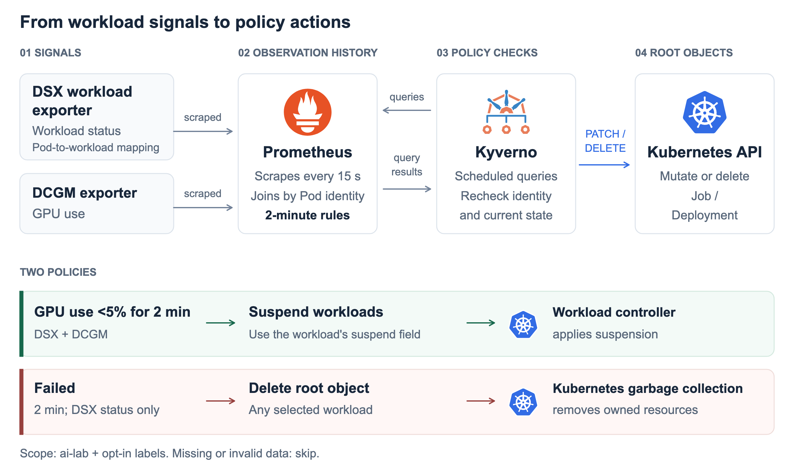

<!-- SPDX-License-Identifier: Apache-2.0 -->
<!-- Copyright (c) 2026 NVIDIA Corporation -->

# Act on workload changes with DSX and Kyverno

A training job holds a GPU while doing no work. Another workload has been failing
for minutes. Releasing idle allocations gives other work room to run.
Removing abandoned workloads avoids manual cleanup.

The DSX workload exporter is the eyes: it connects Pods and their metrics to the
workload that owns them. Kyverno supplies the hands: it changes or deletes the
selected Kubernetes object. Prometheus keeps the observation history.



## The eyes: what can you see?

| Condition | Inputs |
| --- | --- |
| Allocated GPUs stay below 5% use | DCGM utilization plus DSX Pod-to-workload identity. |
| A workload requests 8 CPUs but uses less than 0.1 core | cAdvisor CPU usage, resource requests and DSX identity. |
| Memory use stays far below the requested amount | cAdvisor working-set bytes, resource requests and DSX identity. |
| A workload stays Failed, Degraded or Initializing too long | DSX normalized status, using that workload's catalog definition. |
| Completed work exceeds its retention period | DSX status history. Creation age is not time in a phase. |

DSX supplies workload identity and status. DCGM and cAdvisor supply resource use.
See the [metric joins](../../dsx-workload-exporter/queries.md).
Low use alone does not prove the application is safe to stop; it may be waiting for I/O.

## The hands: how can you respond?

| Response | What Kyverno changes |
| --- | --- |
| Suspend or resume training | Set Job `spec.suspend` to `true` or `false`. |
| Scale or change configuration | Mutate a supported field, such as Deployment `spec.replicas`. Coordinate with autoscalers. |
| Delete abandoned work | Delete the root object; Kubernetes garbage collection removes its owned resources. |

The workload's controller acts on changed fields. Suspension does not checkpoint
training. Choose workloads that can safely restart, and retain outputs before deletion.

## Try two policies

Use a disposable Kubernetes cluster with Helm and kubectl. The examples use
built-in Jobs and Deployments. You need:

- [DSX workload map exporter](../../dsx-workload-exporter/installation.md), configured with the demo values below.
- [Kyverno](https://kyverno.io/docs/installation/installation/), tested with 1.19.1 (chart 3.9.1).
- Prometheus for metric history. The preparation below deploys it.
- For the GPU policy: one dedicated NVIDIA GPU, drivers, device access and [DCGM Exporter](https://docs.nvidia.com/datacenter/dcgm/latest/installation/install-dcgm-exporter.html). Enable Kubernetes mapping and `DCGM_EXPORTER_KUBERNETES_ENABLE_POD_UID=true`.

Prometheus scrapes every five seconds. Both policies require two minutes of fresh,
valid observations for the same workload UID. A UID identifies one object's lifetime.
The GPU rule also matches the Pod UID. Missing data does not count as zero.
Actions are limited to opted-in workloads in `ai-lab`.

The DCGM Service used below must have exactly one exporter endpoint for the demo
GPU node. For multiple nodes, scrape each exporter Pod separately with Kubernetes
discovery instead of one shared Service target.

<details>
<summary>Prepare the demo</summary>

Run this preparation once, from an empty directory. Create the namespaces:

```sh
kubectl apply -f - <<'EOF'
apiVersion: v1
kind: Namespace
metadata:
  name: ai-lab
---
apiVersion: v1
kind: Namespace
metadata:
  name: monitoring
EOF
```

Create the exporter and Kyverno values files:

```sh
cat > dsx-demo-values.yaml <<'EOF'
operator:
  enabled: false
webhook:
  enabled: false
crdUpgrader:
  enabled: false
exporter:
  enabled: true
  selection:
    namespaceSelector:
      matchLabels: {kubernetes.io/metadata.name: ai-lab}
      matchExpressions: []
    includeRootResources:
      - apiGroups: [batch]
        apiVersions: [v1]
        resources: [jobs]
      - apiGroups: [apps]
        apiVersions: [v1]
        resources: [deployments]
    requiredWatchKinds: [batch/v1/Job, apps/v1/Deployment]
  kartaDefinitionSource:
    catalog:
      enabled: true
      include: [batch-job-v1, apps-deployment-v1]
    cluster:
      enabled: false
  rbac:
    workloadRules:
      - apiGroups: [batch]
        resources: [jobs]
      - apiGroups: [apps]
        resources: [deployments, replicasets]
  resources:
    requests: {cpu: 100m, memory: 128Mi}
    limits: {cpu: '1', memory: 512Mi}
EOF
```

```sh
cat > kyverno-demo-values.yaml <<'EOF'
backgroundController:
  extraEnvVars:
    - name: BACKGROUND_SCAN_INTERVAL
      value: 30s
  resources:
    limits:
      memory: 256Mi
cleanupController:
  resources:
    limits:
      memory: 256Mi
reportsController:
  resources:
    limits:
      memory: 256Mi
test:
  image:
    tag: v1.19.1
EOF
```

Follow the installation guides above. Add `-f dsx-demo-values.yaml` to the
exporter's Helm command and `-f kyverno-demo-values.yaml` to Kyverno's. If already
installed, apply these values through that installation's Helm upgrade command.
The exporter observes Jobs and Deployments; Kyverno scans every 30 seconds.

The examples assume DSX is in `karta-system` and Kyverno is in `kyverno`.
Adjust the addresses and service account references below if yours differ.

Load the recording rules into Prometheus's ConfigMap:

```sh
kubectl apply -f - <<'EOF'
apiVersion: v1
kind: ConfigMap
metadata:
  name: prometheus-rules
  namespace: monitoring
data:
  tutorial.yaml: |
    # Scrape and evaluate every 5s. These rules assume one cluster and one exporter.
    # GPU policy coverage is restricted to one Pod with one dedicated GPU.
    groups:
      - name: tutorial
        interval: 5s
        rules:
          - record: tutorial:phase:observed
            expr: |
              max by (namespace, workload_uid, workload_kind, workload_group, phase) (
                (dsx_workload_status{namespace="ai-lab",workload_group=~"batch|apps",workload_kind=~"Job|Deployment",phase=~"Running|Failed",observation_valid="true"} == 1)
                and (time() - timestamp(dsx_workload_status) < 15)
                and on (namespace, workload_uid, phase) (count by (namespace, workload_uid, phase) (dsx_workload_status) == 1)
              )
              unless on (namespace, workload_uid) dsx_workload_status{observation_valid="false"}
              unless on (namespace, workload_uid) dsx_exporter_observation_valid{scope="workload"}
              and on () (up{job="dsx-exporter"} == 1)
              and on () (time() - timestamp(up{job="dsx-exporter"}) < 15)
          - record: tutorial:gpu_idle:observed
            expr: |
              (
                max by (namespace, workload_uid, pod_uid, UUID) (
                  (
                    (DCGM_FI_DEV_GPU_UTIL{namespace="ai-lab",pod_uid!="",UUID!=""} >= 0)
                    and (DCGM_FI_DEV_GPU_UTIL <= 100)
                    and (time() - timestamp(DCGM_FI_DEV_GPU_UTIL) < 15)
                    and on (namespace, pod_uid) (count by (namespace, pod_uid) (DCGM_FI_DEV_GPU_UTIL) == 1)
                  )
                  * on (namespace, pod_uid) group_left (workload_uid)
                  (
                    dsx_workload_pod_info{namespace="ai-lab",workload_group="batch",workload_kind="Job",component="job",observation_valid="true"}
                    and (time() - timestamp(dsx_workload_pod_info) < 15)
                    and on (namespace, workload_uid) (count by (namespace, workload_uid) (dsx_workload_pod_info) == 1)
                  )
                ) < bool 5
              )
              and on (namespace, workload_uid) tutorial:phase:observed{phase="Running",workload_kind="Job"}
              and on () (up{job="dcgm"} == 1)
              and on () (time() - timestamp(up{job="dcgm"}) < 15)
          - record: tutorial:gpu_idle:eligible
            expr: |
              (min_over_time(tutorial:gpu_idle:observed[2m]) == 1)
              and (count_over_time(tutorial:gpu_idle:observed[2m]) == 24)
              and (tutorial:gpu_idle:observed == 1)
              and (tutorial:gpu_idle:observed offset 2m == 1)
              and (time() - 120 - timestamp(tutorial:gpu_idle:observed offset 2m) < 6)
          - record: tutorial:unhealthy:eligible
            expr: |
              (min_over_time(tutorial:phase:observed{phase="Failed"}[2m]) == 1)
              and (count_over_time(tutorial:phase:observed{phase="Failed"}[2m]) == 24)
              and (tutorial:phase:observed{phase="Failed"} == 1)
              and (tutorial:phase:observed{phase="Failed"} offset 2m == 1)
              and (time() - 120 - timestamp(tutorial:phase:observed{phase="Failed"} offset 2m) < 6)
EOF
```

Deploy Prometheus. Change the DCGM target to your installation's service address
before applying this block:

```sh
kubectl apply -f - <<'EOF'
apiVersion: v1
kind: ConfigMap
metadata:
  name: prometheus-config
  namespace: monitoring
data:
  prometheus.yml: |
    global:
      scrape_interval: 5s
      evaluation_interval: 5s
    rule_files:
      - /etc/prometheus/rules/*.yaml
    scrape_configs:
      - job_name: dsx-exporter
        honor_labels: true
        static_configs:
          - targets: [dsx-workload-exporter.karta-system.svc:8080]
      - job_name: dcgm
        honor_labels: true
        # This Service must have exactly one exporter endpoint for the demo GPU node.
        # For multiple nodes, discover and scrape each exporter Pod separately.
        static_configs:
          - targets: [dcgm-exporter.gpu-operator.svc:9400]
---
apiVersion: apps/v1
kind: Deployment
metadata:
  name: prometheus
  namespace: monitoring
spec:
  replicas: 1
  selector:
    matchLabels: {app: prometheus}
  template:
    metadata:
      labels: {app: prometheus}
    spec:
      automountServiceAccountToken: false
      securityContext:
        runAsNonRoot: true
        runAsUser: 65534
        runAsGroup: 65534
        fsGroup: 65534
        seccompProfile: {type: RuntimeDefault}
      containers:
        - name: prometheus
          image: quay.io/prometheus/prometheus:v3.14.0
          args:
            - --config.file=/etc/prometheus/prometheus.yml
            - --storage.tsdb.path=/prometheus
            - --storage.tsdb.retention.time=2h
            - --web.enable-lifecycle
          ports:
            - name: http
              containerPort: 9090
          readinessProbe:
            httpGet: {path: /-/ready, port: http}
          livenessProbe:
            httpGet: {path: /-/healthy, port: http}
          resources:
            requests: {cpu: 100m, memory: 128Mi}
            limits: {cpu: '1', memory: 512Mi}
          securityContext:
            allowPrivilegeEscalation: false
            readOnlyRootFilesystem: true
            capabilities: {drop: [ALL]}
          volumeMounts:
            - name: config
              mountPath: /etc/prometheus
              readOnly: true
            - name: rules
              mountPath: /etc/prometheus/rules
              readOnly: true
            - name: data
              mountPath: /prometheus
      volumes:
        - name: config
          configMap: {name: prometheus-config}
        - name: rules
          configMap: {name: prometheus-rules}
        - name: data
          emptyDir: {}
---
apiVersion: v1
kind: Service
metadata:
  name: prometheus
  namespace: monitoring
spec:
  selector: {app: prometheus}
  ports:
    - name: http
      port: 9090
      targetPort: http
EOF
```

Grant Kyverno permission to act in `ai-lab`. Discovery and reporting also need
cluster-wide read access:

```sh
kubectl apply -f - <<'EOF'
apiVersion: rbac.authorization.k8s.io/v1
kind: Role
metadata:
  name: tutorial-workload-mutation
  namespace: ai-lab
rules:
  - apiGroups: [batch]
    resources: [jobs]
    verbs: [get, list, watch, patch, update]
---
apiVersion: rbac.authorization.k8s.io/v1
kind: RoleBinding
metadata:
  name: tutorial-workload-mutation
  namespace: ai-lab
roleRef:
  apiGroup: rbac.authorization.k8s.io
  kind: Role
  name: tutorial-workload-mutation
subjects:
  - kind: ServiceAccount
    name: kyverno-background-controller
    namespace: kyverno
---
apiVersion: rbac.authorization.k8s.io/v1
kind: Role
metadata:
  name: tutorial-workload-cleanup
  namespace: ai-lab
rules:
  - apiGroups: [batch]
    resources: [jobs]
    verbs: [get, list, watch, delete]
  - apiGroups: [apps]
    resources: [deployments]
    verbs: [get, list, watch, delete]
---
apiVersion: rbac.authorization.k8s.io/v1
kind: RoleBinding
metadata:
  name: tutorial-workload-cleanup
  namespace: ai-lab
roleRef:
  apiGroup: rbac.authorization.k8s.io
  kind: Role
  name: tutorial-workload-cleanup
subjects:
  - kind: ServiceAccount
    name: kyverno-cleanup-controller
    namespace: kyverno
---
apiVersion: rbac.authorization.k8s.io/v1
kind: ClusterRole
metadata:
  name: tutorial-cleanup-workload-list
rules:
  - apiGroups: [batch]
    resources: [jobs]
    verbs: [list]
  - apiGroups: [apps]
    resources: [deployments]
    verbs: [list]
---
apiVersion: rbac.authorization.k8s.io/v1
kind: ClusterRoleBinding
metadata:
  name: tutorial-cleanup-workload-list
roleRef:
  apiGroup: rbac.authorization.k8s.io
  kind: ClusterRole
  name: tutorial-cleanup-workload-list
subjects:
  - kind: ServiceAccount
    name: kyverno-cleanup-controller
    namespace: kyverno
---
apiVersion: rbac.authorization.k8s.io/v1
kind: ClusterRole
metadata:
  name: tutorial-report-training-read
rules:
  - apiGroups: [batch]
    resources: [jobs]
    verbs: [get, list, watch]
---
apiVersion: rbac.authorization.k8s.io/v1
kind: ClusterRoleBinding
metadata:
  name: tutorial-report-training-read
roleRef:
  apiGroup: rbac.authorization.k8s.io
  kind: ClusterRole
  name: tutorial-report-training-read
subjects:
  - kind: ServiceAccount
    name: kyverno-reports-controller
    namespace: kyverno
EOF
```

```sh
kubectl -n karta-system rollout status deployment/dsx-workload-exporter --timeout=3m
kubectl -n monitoring rollout status deployment/prometheus --timeout=3m
```

Both policies query `http://prometheus.monitoring.svc:9090`. Change both policy
URLs below if using a different Prometheus service.

</details>

### 1. Suspend an idle GPU Job

Create a Job that requests one dedicated GPU and intentionally sleeps:

```sh
kubectl apply -f - <<'EOF'
apiVersion: batch/v1
kind: Job
metadata:
  name: idle-training
  namespace: ai-lab
  labels:
    tutorial.workloadmap.run.ai/action: suspend
spec:
  suspend: false
  parallelism: 1
  completions: 1
  backoffLimit: 0
  template:
    spec:
      restartPolicy: Never
      containers:
        - name: training
          image: busybox:1.37.0
          command: [sh, -c, "sleep 3600"]
          resources:
            requests: {cpu: 5m, memory: 8Mi}
            limits: {nvidia.com/gpu: 1, cpu: 100m, memory: 32Mi}
EOF
```

Apply this policy. It selects Jobs labeled `tutorial.workloadmap.run.ai/action: suspend`
and sets `spec.suspend=true` after GPU use stays below 5% for two minutes.
It requires one parallel Pod, one completion and one dedicated GPU. GPU sharing
and MIG need different attribution rules.

```sh
kubectl apply -f - <<'EOF'
apiVersion: policies.kyverno.io/v1
kind: MutatingPolicy
metadata:
  name: tutorial-suspend-idle-training
spec:
  matchConstraints:
    namespaceSelector:
      matchLabels: {kubernetes.io/metadata.name: ai-lab}
    objectSelector:
      matchLabels: {tutorial.workloadmap.run.ai/action: suspend}
    resourceRules:
      - apiGroups: [batch]
        apiVersions: [v1]
        operations: [CREATE, UPDATE]
        resources: [jobs]
  evaluation:
    admission: {enabled: false}
    mutateExisting: {enabled: true}
  targetMatchConditions:
    - name: still-opted-in-and-running
      expression: >-
        object.metadata.namespace == 'ai-lab' &&
        has(object.metadata.labels) && 'tutorial.workloadmap.run.ai/action' in object.metadata.labels &&
        object.metadata.labels['tutorial.workloadmap.run.ai/action'] == 'suspend' &&
        !object.spec.?suspend.orValue(false) && !has(object.metadata.deletionTimestamp) &&
        object.status.?active.orValue(0) > 0 && object.status.?ready.orValue(0) > 0 &&
        !object.status.?conditions.orValue([]).exists(c,
          c.type in ['Complete', 'SuccessCriteriaMet', 'Failed', 'FailureTarget'] && c.status == 'True')
    - name: one-pod-one-container-one-gpu
      expression: >-
        object.spec.?parallelism.orValue(1) == 1 && object.spec.?completions.orValue(1) == 1 &&
        size(object.spec.template.spec.containers) == 1 &&
        size(object.spec.template.spec.?initContainers.orValue([])) == 0 &&
        string(object.spec.template.spec.containers[0].resources.limits['nvidia.com/gpu']) == '1'
    - name: two-minutes-of-low-gpu-use-for-this-object
      expression: >-
        http.Get('http://prometheus.monitoring.svc:9090/api/v1/query?query=tutorial:gpu_idle:eligible%20and%20(time()-timestamp(tutorial:gpu_idle:eligible)%3C15)').data.result.exists(r,
          r.metric.workload_uid == object.metadata.uid && r.metric.namespace == object.metadata.namespace)
  mutations:
    - patchType: JSONPatch
      jsonPatch:
        expression: "[JSONPatch{op: 'add', path: '/spec/suspend', value: true}]"
EOF
```

Allow two minutes of observations, then the next scan. Check the result:

```sh
kubectl -n ai-lab wait --for=jsonpath='{.spec.suspend}'=true job/idle-training --timeout=5m
kubectl -n ai-lab get job idle-training -o jsonpath='{.spec.suspend}{"\n"}'
kubectl -n ai-lab get pods -l batch.kubernetes.io/job-name=idle-training
```

Expect `true`. The Job controller removes its active Pod, releasing the GPU
allocation. The Job remains. To opt out and resume it:

```sh
kubectl -n ai-lab patch job idle-training --type=merge -p \
  '{"metadata":{"labels":{"tutorial.workloadmap.run.ai/action":"observe"}},"spec":{"suspend":false}}'
```

The controller creates a new Pod. Training restarts unless the application can
restore a checkpoint.

### 2. Delete work that stays Failed

Create a Job that exits with an error and a Deployment whose readiness probe
fails. DSX reports the Deployment as Failed after its progress deadline expires:

```sh
kubectl apply -f - <<'EOF'
apiVersion: batch/v1
kind: Job
metadata:
  name: failed-training
  namespace: ai-lab
  labels:
    tutorial.workloadmap.run.ai/action: delete
spec:
  parallelism: 1
  completions: 1
  backoffLimit: 0
  template:
    spec:
      restartPolicy: Never
      containers:
        - name: training
          image: busybox:1.37.0
          command: [sh, -c, "exit 1"]
          resources:
            requests: {cpu: 5m, memory: 8Mi}
            limits: {cpu: 100m, memory: 32Mi}
---
apiVersion: apps/v1
kind: Deployment
metadata:
  name: failed-service
  namespace: ai-lab
  labels:
    tutorial.workloadmap.run.ai/action: delete
spec:
  replicas: 1
  progressDeadlineSeconds: 10
  selector:
    matchLabels: {app: failed-service}
  template:
    metadata:
      labels: {app: failed-service}
    spec:
      containers:
        - name: app
          image: busybox:1.37.0
          command: [sh, -c, "sleep 3600"]
          readinessProbe:
            exec: {command: [sh, -c, "exit 1"]}
            periodSeconds: 2
          resources:
            requests: {cpu: 5m, memory: 8Mi}
            limits: {cpu: 100m, memory: 32Mi}

EOF
```

Apply this policy. It selects objects labeled `tutorial.workloadmap.run.ai/action: delete`
and deletes them after two minutes in Failed. It rechecks the current object
before acting:

```sh
kubectl apply -f - <<'EOF'
apiVersion: policies.kyverno.io/v1
kind: DeletingPolicy
metadata:
  name: tutorial-delete-unhealthy
spec:
  matchConstraints:
    namespaceSelector:
      matchLabels: {kubernetes.io/metadata.name: ai-lab}
    objectSelector:
      matchLabels: {tutorial.workloadmap.run.ai/action: delete}
    resourceRules:
      - apiGroups: [batch]
        apiVersions: [v1]
        operations: [CREATE, UPDATE]
        resources: [jobs]
      - apiGroups: [apps]
        apiVersions: [v1]
        operations: [CREATE, UPDATE]
        resources: [deployments]
  schedule: "*/1 * * * *"
  deletionPropagationPolicy: Background
  conditions:
    - name: still-failed
      expression: >-
        (object.kind == 'Job' && object.status.?conditions.orValue([]).exists(c,
          c.type in ['Failed', 'FailureTarget'] && c.status == 'True')) ||
        (object.kind == 'Deployment' && object.status.?conditions.orValue([]).exists(c,
          c.type == 'Progressing' && c.status == 'False' && c.reason == 'ProgressDeadlineExceeded') &&
          string(object.status.observedGeneration) == string(object.metadata.generation))
    - name: two-minutes-in-that-phase-for-this-object
      expression: >-
        http.Get('http://prometheus.monitoring.svc:9090/api/v1/query?query=tutorial:unhealthy:eligible%20and%20(time()-timestamp(tutorial:unhealthy:eligible)%3C15)').data.result.exists(r,
          r.metric.workload_uid == object.metadata.uid && r.metric.namespace == object.metadata.namespace && r.metric.workload_kind == object.kind)

EOF
```

Allow two minutes in Failed, then the next scheduled scan. Check deletion:

```sh
kubectl -n ai-lab wait --for=delete job/failed-training deployment/failed-service --timeout=5m
kubectl -n ai-lab get jobs,deployments,pods
```

Both waits should succeed. Kubernetes garbage collection removes the deleted
objects' owned resources. The resumed `idle-training` Job remains.

Remove the policies and remaining example Job when finished:

```sh
kubectl delete mutatingpolicy tutorial-suspend-idle-training
kubectl delete deletingpolicy tutorial-delete-unhealthy
kubectl -n ai-lab delete job idle-training
```

## Validation

Tested on kind with Kubernetes 1.34.3, Kyverno 1.19.1 and Prometheus 3.14.0.
Suspension, deletion, resume, object replacement, exporter-outage recovery and
namespace permissions passed.

The GPU capacity and DCGM readings were simulated; physical GPU attribution
and cAdvisor-driven actions were not tested. The [22 rule tests](tests/rules_test.yaml)
cover timing, missing or invalid measurements, and object replacement.

[Kyverno 1.19.1](https://github.com/kyverno/kyverno/blob/v1.19.1/pkg/controllers/deleting/controller.go#L154)
checks an object, then deletes it by name without a UID precondition.
A same-name replacement created between those operations can be deleted.
Matching metric UIDs does not make deletion atomic. These examples are intended
for a disposable lab.
