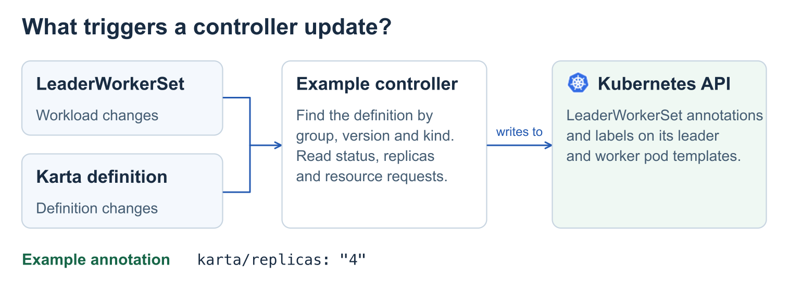

{/* SPDX-License-Identifier: Apache-2.0 */}
{/* Copyright (c) 2026 NVIDIA Corporation */}

Deploy a controller that reads a LeaderWorkerSet, annotates it with its status and resource requests, and labels its leader and worker pod templates. On each reconcile, the controller reads the workload's structure from a `Karta` definition in the cluster. Editing that definition changes what the controller reads.



You can run the [Go library quickstart](../quickstart/index.mdx) offline first.

## Prerequisites

- [kind](https://kind.sigs.k8s.io/), `kubectl`, and `docker`.
- A clone of the repository. The commands run from the repository root:

  ```bash
  git clone https://github.com/dsx-ai-factory/workload-map.git
  cd workload-map
  ```

The example is a standalone Go module. Its local `replace` directive selects the repository library in `karta/sdk/`, so the image is built from the repository root.

## What the Controller Does

The [example controller](https://github.com/dsx-ai-factory/workload-map/blob/main/docs/tutorials/controller-runtime/controller.go) selects the definition whose root component matches the workload's group, version, and kind. It reads status, scale, and resource requests from the workload and uses the definition to find the pod templates to label. For the sequence of reads and writes, see [How a Reconcile Loop Is Structured](../../building-on-workload-map/build-a-controller/how-a-controller-uses-workload-map.mdx#how-a-reconcile-loop-is-structured).

## Create a Cluster

Create a kind cluster:

```bash
kind create cluster
```

## Install the LeaderWorkerSet Operator

The CRD and the controller of LeaderWorkerSet are not built into Kubernetes. Install them:

```bash
VERSION=v0.8.0
kubectl apply --server-side -f https://github.com/kubernetes-sigs/lws/releases/download/$VERSION/manifests.yaml
kubectl -n lws-system rollout status deploy/lws-controller-manager
```

## Install the Karta CRD and the Definition

Install the `Karta` CRD, then apply the LeaderWorkerSet definition. The order matters. The CRD must exist before the object that uses it.

```bash
kubectl apply -f charts/karta/crds/run.ai_kartas.yaml
kubectl apply -f docs/catalog/leaderworkerset-x-k8s-io-leaderworkerset-v1.yaml
```

The [LeaderWorkerSet definition](https://github.com/dsx-ai-factory/workload-map/blob/main/docs/catalog/leaderworkerset-x-k8s-io-leaderworkerset-v1.yaml) maps the leader and worker templates and the computed worker replica count. The controller therefore reads and writes them with plain `GetPodTemplateSpec` and `UpdatePodTemplateSpec` calls.

## Build and Deploy the Controller

Build the controller image and side-load it into the cluster:

```bash
# Derive the Go version from go.mod so the build image stays aligned with it.
GO_VERSION=$(awk '/^go /{print $2}' docs/tutorials/controller-runtime/go.mod)
docker build --build-arg GO_VERSION=$GO_VERSION \
  -f docs/tutorials/controller-runtime/Dockerfile -t generic-controller-example:latest .
kind load docker-image generic-controller-example:latest
```

Deploy the controller:

```bash
kubectl apply -f docs/tutorials/controller-runtime/manifests/
kubectl -n karta-system rollout status deploy/generic-controller
```

## Apply a LeaderWorkerSet and See the Result

Apply the LeaderWorkerSet and inspect what the controller wrote:

```bash
kubectl apply -f docs/tutorials/controller-runtime/samples/leaderworkerset.yaml

# Karta-derived annotations on the LeaderWorkerSet metadata
kubectl get leaderworkerset karta-demo-lws -o jsonpath='{.metadata.annotations}' | tr ',' '\n'

# The label is injected into both the leader and worker templates
kubectl get leaderworkerset karta-demo-lws \
  -o jsonpath='leader={.spec.leaderWorkerTemplate.leaderTemplate.metadata.labels}{"\n"}worker={.spec.leaderWorkerTemplate.workerTemplate.metadata.labels}{"\n"}'

# The injected label also reaches the running pods
kubectl get pods -l app.kubernetes.io/managed-by=karta

# Events recorded by the controller
kubectl describe leaderworkerset karta-demo-lws | sed -n '/Events:/,$p'
```

When the group is ready, the annotations are as follows. The `replicas` value sums the group, the leader component, and the worker component. The `cpu` and `memory` values sum the leader and worker requests.

```text
karta/status: Running
karta/replicas: 4
karta/cpu-request: 200m
karta/memory-request: 128Mi
karta/gpu-request: 0
```

The controller records the label injection as a single event:

```text
Normal  PodTemplateLabeled  Injected pod-template label app.kubernetes.io/managed-by=karta via Karta
```

<Note title="Pod templates can be changed while the workload runs">
The pod templates of a LeaderWorkerSet can be changed while it runs. An update triggers a normal rolling update, and the LeaderWorkerSet has no suspend field. For this reason, the controller injects the managed-by label directly into the leader and worker templates, and the library routes each update to the correct path in the workload.
</Note>

## Trigger a Status Change

The controller records the first observed status silently, so a new workload does not emit a `StatusChanged` event. To see one, cause a status transition. For example, start a rolling update, which the controller sees go back through `Initializing` and into `Running`:

```bash
kubectl patch leaderworkerset karta-demo-lws --type=json \
  -p '[{"op":"replace","path":"/spec/leaderWorkerTemplate/workerTemplate/spec/containers/0/image","value":"busybox:1.38"}]'
kubectl describe leaderworkerset karta-demo-lws | sed -n '/Events:/,$p'
```

The event looks like the following:

```text
Normal  StatusChanged  Workload status changed: Running -> Initializing (replicas=4 cpu=200m memory=128Mi gpu=0)
```

## Change the Definition Live

The controller also watches `Karta` objects. When you edit the object whose root component is `leaderworkerset.x-k8s.io/v1 LeaderWorkerSet`, the controller reconciles every governed LeaderWorkerSet again with the new structure, with no redeploy:

```bash
kubectl edit karta leaderworkerset-x-k8s-io-leaderworkerset-v1
# change something the controller reports, then save
```

For ready-made definitions for PyTorchJob, RayCluster, JobSet, and more, refer to the [Catalog of Definitions](../../reference/catalog-of-definitions.mdx).

## Watch Another Workload Type

To extend the running controller to JobSet, follow these steps before cleaning up the cluster.

The `--watch-gvk` flag takes a comma-separated list of workload types. Write each type as `group/version/kind`. The core group is empty, so a Pod is `/v1/Pod`. The default value is `leaderworkerset.x-k8s.io/v1/LeaderWorkerSet`.

The controller creates one watch and one reconciler for each configured type at startup. A change to the flag therefore takes effect on the next rollout.

### Add JobSet

1. Install the JobSet operator. The controller can watch only the types that the API server knows:

   ```bash
   VERSION=v0.12.0
   kubectl apply --server-side -f https://github.com/kubernetes-sigs/jobset/releases/download/$VERSION/manifests.yaml
   ```

2. Apply the definition of JobSet:

   ```bash
   kubectl apply -f docs/catalog/jobset-x-k8s-io-jobset-v1alpha2.yaml
   ```

3. Add the type to the flag in `docs/tutorials/controller-runtime/manifests/01-deployment.yaml`:

   ```yaml
   args:
     - --watch-gvk=leaderworkerset.x-k8s.io/v1/LeaderWorkerSet,jobset.x-k8s.io/v1alpha2/JobSet
   ```

4. Grant RBAC for the new resource in `docs/tutorials/controller-runtime/manifests/00-rbac.yaml`:

   ```yaml
   - apiGroups: ["jobset.x-k8s.io"]
     resources: ["jobsets"]
     verbs: ["get", "list", "watch", "update", "patch"]
   ```

5. Apply the manifests again:

   ```bash
   kubectl apply -f docs/tutorials/controller-runtime/manifests/
   ```

6. Wait for the controller to roll out, then apply the sample JobSet. The sample sets `spec.suspend: true` so the controller can label its pod template before any pods are created:

   ```bash
   kubectl -n karta-system rollout status deploy/generic-controller
   kubectl apply -f docs/tutorials/controller-runtime/samples/jobset.yaml
   ```

7. Wait for the template label, resume the JobSet, and list its pods that inherited the label:

   ```bash
   kubectl wait jobset/karta-demo-jobset-suspended --timeout=90s \
     --for='jsonpath={.spec.replicatedJobs[0].template.spec.template.metadata.labels.app\.kubernetes\.io/managed-by}=karta'
   kubectl patch jobset karta-demo-jobset-suspended --type=merge -p '{"spec":{"suspend":false}}'
   kubectl get pods -l jobset.sigs.k8s.io/jobset-name=karta-demo-jobset-suspended,app.kubernetes.io/managed-by=karta
   ```

## Clean Up

Delete the kind cluster to remove the controller, workloads, and installed operators:

```bash
kind delete cluster
```

## What You Learned

- A controller can read, aggregate, and change any workload that has a definition, with no code for a specific workload type.
- The controller finds the definition in the cluster, so a change to the definition changes the behavior of the controller without a redeploy.
- The files of the example and their purpose:

  | File | Purpose |
  | --- | --- |
  | `main.go` | Manager setup: scheme, one reconciler per watched type, start. |
  | `controller.go` | The `WorkloadReconciler` inspect and change loop, with no per-CRD branching. |
  | `Dockerfile` | Builds the controller image from the repository root. |
  | `manifests/00-rbac.yaml` | Namespace, ServiceAccount, ClusterRole, and ClusterRoleBinding. Applied first. |
  | `manifests/01-deployment.yaml` | The controller Deployment in the `karta-system` namespace. |
  | `samples/leaderworkerset.yaml` | A LeaderWorkerSet with leader and worker child templates and a computed worker count. |
  | `samples/jobset.yaml` | A suspended JobSet for the second watch. |

## Next Steps

- To add a workload type that has no catalog definition, see [Define a Workload Type](../../building-on-workload-map/define-a-workload-type.mdx).
- To write your own code against the library, refer to [Use the Go Library](../../building-on-workload-map/build-a-controller/use-the-go-library.mdx).
