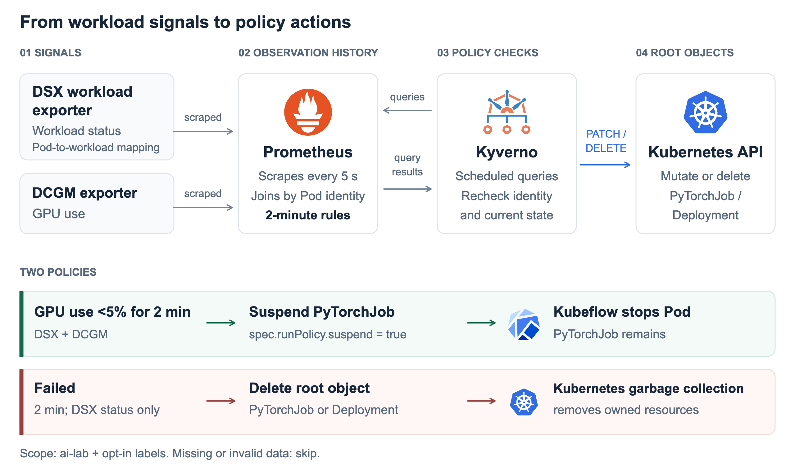

<!-- SPDX-License-Identifier: Apache-2.0 -->
<!-- Copyright (c) 2026 NVIDIA Corporation -->

# Act on workload changes with DSX and Kyverno

A training job holds a GPU while doing no work. Another workload has been failing
for minutes. Releasing idle allocations gives other work room to run.
Removing abandoned workloads avoids manual cleanup.

The DSX workload exporter is the eyes: it connects Pods and their metrics to the
workload that owns them. Kyverno supplies the hands: it changes or deletes the
selected Kubernetes object. Prometheus keeps the observation history.



## The eyes: what can you see?

| Condition | Inputs |
| --- | --- |
| Allocated GPUs stay below 5% use | DCGM utilization plus DSX Pod-to-workload identity. |
| A workload requests 8 CPUs but uses less than 0.1 core | cAdvisor CPU usage, resource requests and DSX identity. |
| Memory use stays far below the requested amount | cAdvisor working-set bytes, resource requests and DSX identity. |
| A workload stays Failed, Degraded or Initializing too long | DSX normalized status, using that workload's catalog definition. |
| Completed work exceeds its retention period | DSX status history. Creation age is not time in a phase. |

DSX supplies workload identity and status. DCGM and cAdvisor supply resource use.
See the [metric joins](../../dsx-workload-exporter/queries.md).
Low use alone does not prove the application is safe to stop; it may be waiting for I/O.

## The hands: how can you respond?

| Response | What Kyverno changes |
| --- | --- |
| Suspend or resume training | Set PyTorchJob `spec.runPolicy.suspend` to `true` or `false`. |
| Scale or change configuration | Mutate a supported field, such as Deployment `spec.replicas`. Coordinate with autoscalers. |
| Delete abandoned work | Delete the root object; Kubernetes garbage collection removes its owned resources. |

The workload's controller acts on changed fields. Suspension does not checkpoint
training. Choose workloads that can safely restart, and retain outputs before deletion.

## Try two policies

Use a disposable Kubernetes cluster and an `ai-lab` namespace. Install:

- [Kubeflow Training Operator v1.9.0](https://github.com/kubeflow/trainer/tree/v1.9.0/manifests/overlays/standalone) for the PyTorchJob examples. Deployment is built into Kubernetes.
- Install the [DSX workload map exporter](../../dsx-workload-exporter/installation.md).
- [Kyverno](https://kyverno.io/docs/installation/installation/), tested with 1.19.1 (chart 3.9.1).
- [Prometheus](manifests/prometheus.yaml) for metric history and the two-minute rules. The commands below deploy it.
- The GPU example requires one dedicated NVIDIA GPU, drivers, device access and [DCGM Exporter](https://docs.nvidia.com/datacenter/dcgm/latest/installation/install-dcgm-exporter.html). Enable Kubernetes mapping and `DCGM_EXPORTER_KUBERNETES_ENABLE_POD_UID=true`.

Use the [exporter values](manifests/exporter-values.yaml) to observe PyTorchJobs
and Deployments. Apply the [Kyverno values](manifests/kyverno-values.yaml) when installing;
they set the background scan to 30 seconds.

The [Prometheus example](manifests/prometheus.yaml) scrapes DSX and DCGM every five
seconds and loads the [recording rules](manifests/prometheus-rules.yaml).
Adjust its DCGM service address for your installation. Policies query
`http://prometheus.monitoring.svc:9090`; change both policy URLs if yours differs.
The rules require fresh, valid observations for the same workload and Pod UIDs.
A UID identifies one object lifetime. Missing measurements do not count as zero.

From this repository, create the demo namespaces, load Prometheus and grant
Kyverno its [permissions](manifests/kyverno-rbac.yaml). Actions are limited to
`ai-lab`; controller discovery and reporting also need cluster-wide read access:

```sh
kubectl apply -f docs/tutorials/kyverno-exporter/manifests/namespaces.yaml
kubectl -n monitoring create configmap prometheus-rules --from-file=tutorial.yaml=docs/tutorials/kyverno-exporter/manifests/prometheus-rules.yaml --dry-run=client -o yaml | kubectl apply -f -
kubectl apply -f docs/tutorials/kyverno-exporter/manifests/prometheus.yaml
kubectl apply -f docs/tutorials/kyverno-exporter/manifests/kyverno-rbac.yaml
```

### 1. Suspend idle PyTorch training

The [example workloads](manifests/workloads.yaml) include `idle-training`: a
PyTorchJob whose one Master requests one dedicated GPU and intentionally sleeps.
Only Jobs labeled `tutorial.karta.run.ai/action: suspend` are selected.
This policy sets `spec.runPolicy.suspend=true` after GPU use stays below 5% for
two minutes. Use dedicated GPUs only. The policy excludes worker replicas and multi-GPU Jobs.
GPU sharing and MIG need different attribution rules.

The [complete MutatingPolicy](manifests/policies.yaml) checks the current target
and uses these fields to match its UID and suspend it:

```yaml
targetMatchConditions:
  - name: two-minutes-of-low-gpu-use-for-this-object
    expression: >-
      http.Get('http://prometheus.monitoring.svc:9090/api/v1/query?query=tutorial:gpu_idle:eligible%20and%20(time()-timestamp(tutorial:gpu_idle:eligible)%3C15)').data.result.exists(r,
        r.metric.workload_uid == object.metadata.uid && r.metric.namespace == object.metadata.namespace)
mutations:
  - patchType: JSONPatch
    jsonPatch:
      expression: "[JSONPatch{op: 'add', path: '/spec/runPolicy/suspend', value: true}]"
```

Kubeflow terminates its Pod. The PyTorchJob remains. This releases the allocation,
so another workload can use it. Resume only after opting out of this policy.

### 2. Delete work that stays Failed

The same workload file includes `failed-training`, which exits with an error,
and `failed-service`, a native Deployment whose readiness probe fails.
After the Deployment exceeds its progress deadline, DSX reports both workloads
as Failed. Only objects labeled
`tutorial.karta.run.ai/action: delete` are selected. The
[complete DeletingPolicy](manifests/policies.yaml) uses these conditions:

```yaml
schedule: "*/1 * * * *"
deletionPropagationPolicy: Background
conditions:
  - name: still-failed
    expression: >-
      (object.kind == 'PyTorchJob' && object.status.?conditions.orValue([]).exists(c, c.type == 'Failed' && c.status == 'True')) ||
      (object.kind == 'Deployment' && object.status.?conditions.orValue([]).exists(c,
        c.type == 'Progressing' && c.status == 'False' && c.reason == 'ProgressDeadlineExceeded') &&
        string(object.status.observedGeneration) == string(object.metadata.generation))
  - name: two-minutes-in-that-phase-for-this-object
    expression: >-
      http.Get('http://prometheus.monitoring.svc:9090/api/v1/query?query=tutorial:unhealthy:eligible%20and%20(time()-timestamp(tutorial:unhealthy:eligible)%3C15)').data.result.exists(r,
        r.metric.workload_uid == object.metadata.uid && r.metric.namespace == object.metadata.namespace && r.metric.workload_kind == object.kind)
```

Apply the workloads and both policies:

```sh
kubectl apply -f docs/tutorials/kyverno-exporter/manifests/workloads.yaml
kubectl apply -f docs/tutorials/kyverno-exporter/manifests/policies.yaml
```

Allow two minutes in the matching state, then the next policy scan. Check the results:

```sh
kubectl -n ai-lab get pytorchjob idle-training -o jsonpath='{.spec.runPolicy.suspend}{"\n"}'
kubectl -n ai-lab wait --for=delete pytorchjob/failed-training deployment/failed-service --timeout=5m
kubectl -n ai-lab get pods
```

Expect `true`, both delete waits to succeed, and the example Pods to disappear.
Kubernetes garbage collection removes the deleted roots' owned resources.
To resume the idle Job and keep it running:

```sh
kubectl -n ai-lab patch pytorchjob idle-training --type=merge -p \
  '{"metadata":{"labels":{"tutorial.karta.run.ai/action":"observe"}},"spec":{"runPolicy":{"suspend":false}}}'
```

Kubeflow creates a new Pod. Remove the two policies when finished:

```sh
kubectl delete mutatingpolicy tutorial-suspend-idle-training
kubectl delete deletingpolicy tutorial-delete-unhealthy
```

## Validation

Tested on kind with Kubernetes 1.34.3, Kyverno 1.19.1, Kubeflow 1.9.0
and Prometheus 3.14.0. Live checks covered suspension, resume, Failed-workload
deletion, ReplicaSet and Pod cleanup, and unchanged control workloads.
The GPU capacity and DCGM readings were simulated; physical GPU attribution
and cAdvisor-driven actions were not tested. The [22 rule tests](tests/rules_test.yaml)
cover timing, missing or invalid measurements, and object replacement.

Metrics and mutations are separate operations. A workload can change between them.
These examples are intended for a disposable lab.
