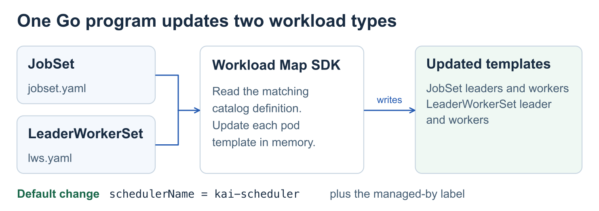

{/* SPDX-License-Identifier: Apache-2.0 */}
{/* Copyright (c) 2026 NVIDIA Corporation */}

A scheduler integration needs to set `schedulerName` on every pod template. A JobSet stores those templates in its replicated jobs. A LeaderWorkerSet has separate templates for its leaders and workers. In this tutorial you use one Go program to read both workloads, set their scheduler, and check which templates changed. Everything runs against local YAML files.



## Prerequisites

Install Git and [Go](https://go.dev/doc/install). The quickstart's [go.mod](https://github.com/dsx-ai-factory/workload-map/blob/main/docs/tutorials/quickstart/go.mod) declares the required Go version. With automatic toolchain selection enabled, Go 1.21 or later can download that version on the first run.

## Quickstart Steps

Clone the repository and enter the tutorial's Go module. It uses the SDK from the same checkout.

```bash
git clone https://github.com/dsx-ai-factory/workload-map.git
cd workload-map/docs/tutorials/quickstart
go list -m -f '{{.GoVersion}}'
go run .
```

The first run downloads the Go dependencies. For each workload, the program prints its status, replicas, and resource requests. It then sets `spec.schedulerName` to `kai-scheduler` and adds the label `app.kubernetes.io/managed-by=karta` on each pod template. The verification lines show the values read back from the modified workload. The order of JobSet instances in those lines can vary.

<Accordion title="Expected output for both workloads">

```text
══════════════════════════════════════════
  JobSet  (scheduler: kai-scheduler)
══════════════════════════════════════════

=== Workload status ===
  Karta workload status: Running

=== Component replica counts ===
  replicatedjob[leader]        replicas=1
  replicatedjob[workers]       replicas=8

=== Resource requests per component ===
  replicatedjob[leader]        container=training     cpu=4        memory=32Gi       gpu=1
  replicatedjob[workers]       container=training     cpu=8        memory=64Gi       gpu=4

=== Injecting scheduler "kai-scheduler" + label ===
  Injected into "replicatedjob" (2 instances)

=== Verification ===
  replicatedjob[leader]        schedulerName="kai-scheduler"      managed-by="karta"
  replicatedjob[workers]       schedulerName="kai-scheduler"      managed-by="karta"

  → In a real controller: k8sClient.Update(ctx, updated)

══════════════════════════════════════════
  LeaderWorkerSet  (scheduler: kai-scheduler)
══════════════════════════════════════════

=== Workload status ===
  Karta workload status: Initializing

=== Component replica counts ===
  group (virtual)              replicas=4
  leader                       replicas=3
  worker                       replicas=9

=== Resource requests per component ===
  leader                       container=nginx2       cpu=500m     memory=512Mi      gpu=<none>
  worker                       container=nginx        cpu=200m     memory=256Mi      gpu=<none>

=== Injecting scheduler "kai-scheduler" + label ===
  Injected into "leader" (1 instance)
  Injected into "worker" (1 instance)

=== Verification ===
  leader                       schedulerName="kai-scheduler"      managed-by="karta"
  worker                       schedulerName="kai-scheduler"      managed-by="karta"

  → In a real controller: k8sClient.Update(ctx, updated)
```

</Accordion>

To choose a different scheduler and print the updated YAML, run:

```bash
go run . --scheduler volcano --print-mutated
```

Look for `schedulerName: volcano` in both replicated jobs and in the leader and worker templates. Run `go run . --help` to list the flags.

## How the program finds the templates

The program embeds [jobset.yaml](https://github.com/dsx-ai-factory/workload-map/blob/main/docs/tutorials/quickstart/jobset.yaml) and [lws.yaml](https://github.com/dsx-ai-factory/workload-map/blob/main/docs/tutorials/quickstart/lws.yaml). For each object it loads the corresponding definition from the [catalog](../../reference/catalog-of-definitions.mdx). The workload contains the values. The definition supplies the jq expressions that locate them.

| Workload object | What its definition reads | Result for the sample |
| --- | --- | --- |
| JobSet | Each `.spec.replicatedJobs[]` entry supplies its name, pod template, replicas and parallelism. | The `workers` entry requests four jobs with two pods each. The reported replica count is eight. |
| LeaderWorkerSet | The definition reads the leader and worker templates separately. It computes workers as `groups * (group size - 1)`, allowing one leader per group. | Three groups of four pods produce three leaders and nine workers. |

The `run` function builds a component factory from the definition and the workload object, then builds a tree to read status, replicas, and resources:

```go
factory := resource.NewComponentFactoryFromObject(karta, obj)
wt, err := tree.Build(ctx, factory)
```

The program reads the templates of each pod-bearing component with `GetPodTemplateSpec`. It updates the scheduler and label in those templates, keeps their instance IDs, and passes the changes to `UpdatePodTemplateSpec`. Finally, `factory.GetResource()` returns the updated workload. A controller can submit that object to the API server. You can follow the complete sequence in [main.go](https://github.com/dsx-ai-factory/workload-map/blob/main/docs/tutorials/quickstart/main.go).

## Next steps

- Run the [Kind controller tutorial](../controller-runtime/index.mdx) to see updates reach a cluster.
- [Write your first workload definition](../../getting-started/tutorial-write-your-first-workload-definition.mdx) to describe another workload type.
- See [Use the Go Library](../../building-on-workload-map/build-a-controller/use-the-go-library.mdx) for the component API and the [Workload Definition Spec](../../reference/workload-definition-spec.mdx) for the supported mappings.
