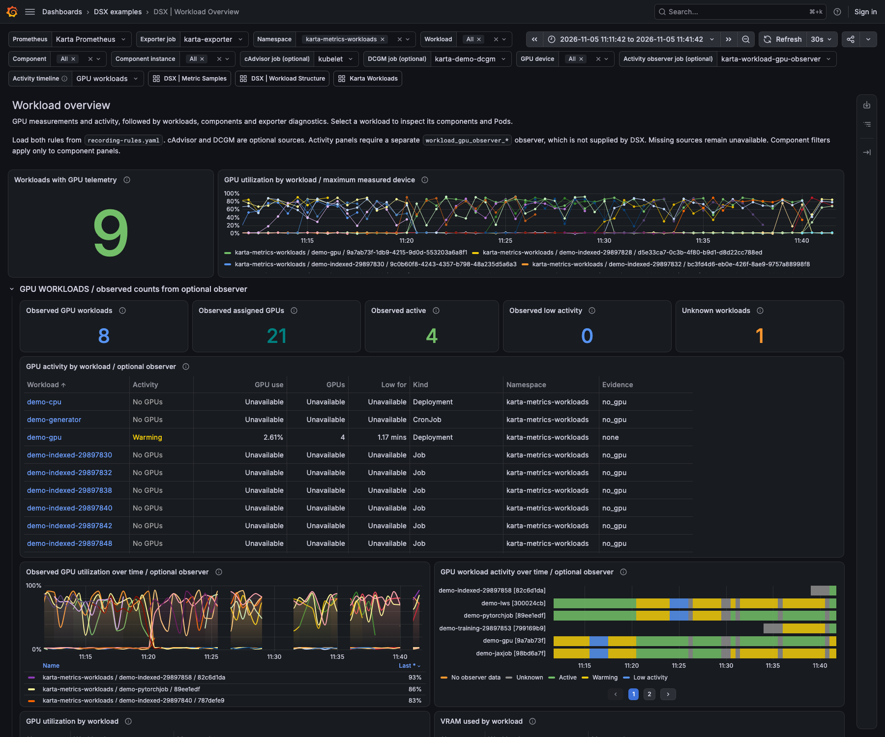
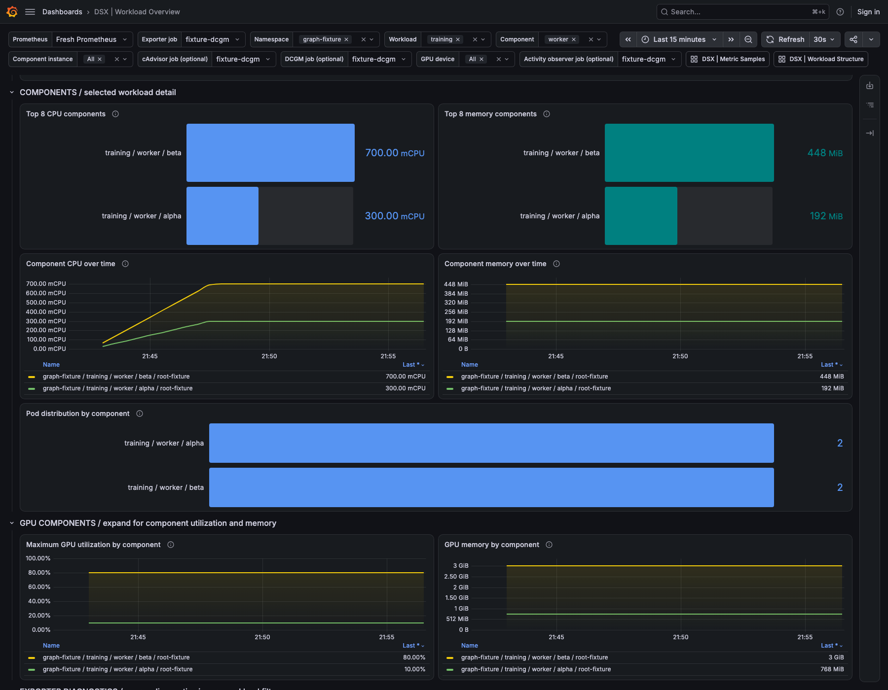
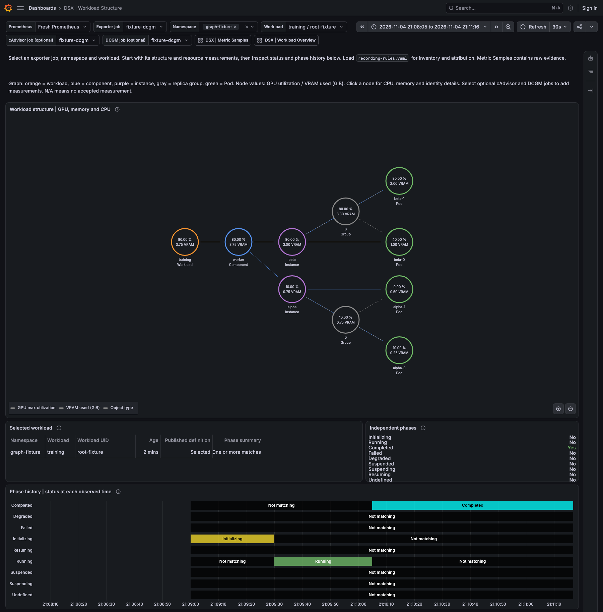
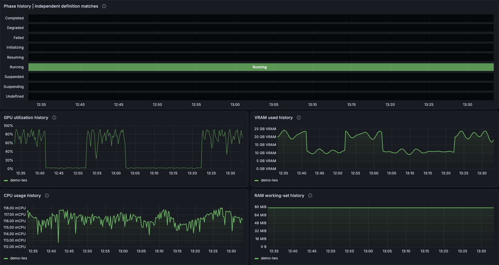
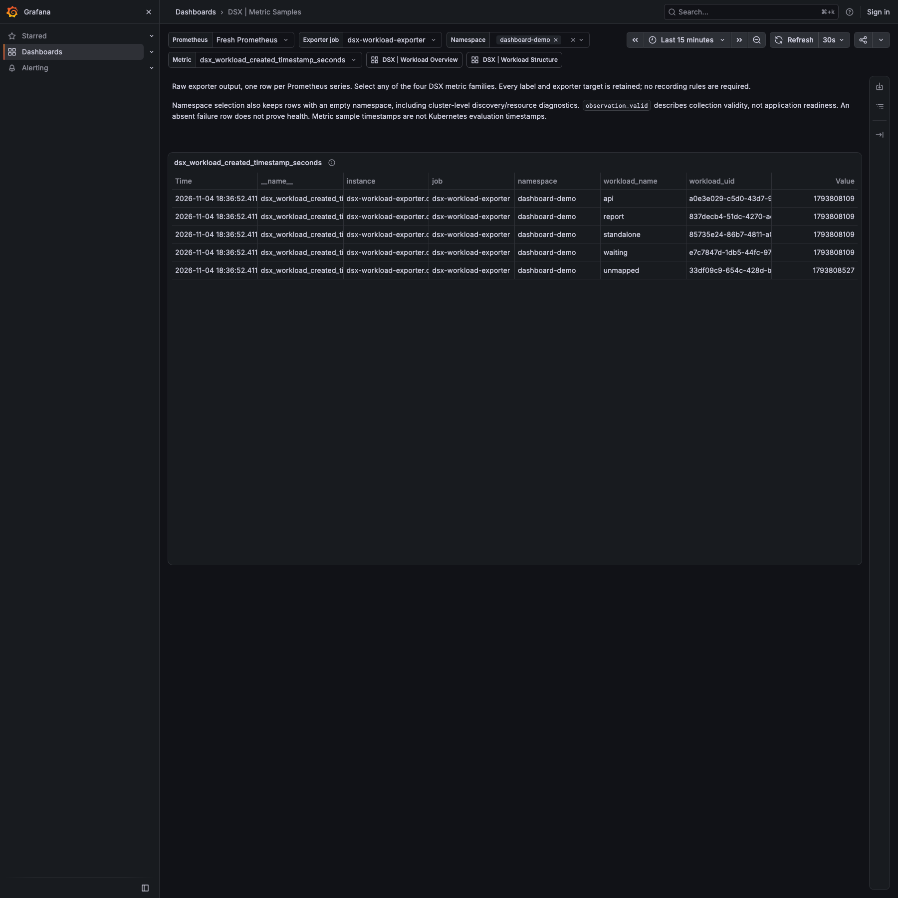

<!-- SPDX-License-Identifier: Apache-2.0 -->
<!-- Copyright (c) 2026 NVIDIA Corporation -->

# Grafana dashboard examples

Two dashboards cover the main flow: find a workload, then inspect what is inside
it. They use native Grafana panels and refresh every 30 seconds. These are
editable examples for an existing Grafana and Prometheus installation.

## All workloads

[Import Workload Overview](workload-overview.json). GPU summary cards and activity
come first. Workload charts, inventory, phase history and component details follow.
Use the workload filter to narrow the overview. Component and instance filters
apply to the component sections. Select a workload name to open its structure.
The Activity timeline filter defaults to GPU workloads, with Active first. Choose
Active only or All workloads as needed. It uses the last accepted state in the
selected range and preserves each displayed workload's earlier transitions.

The overview includes VRAM usage, workload age, zero-Pod roots, independent phase
history and collection failures. Expand the detail sections when needed.





## Inside one workload

[Import Workload Structure](workload-structure.json). Select one workload by UID.
Read the graph from top to bottom: workload, components, instances, groups, then
Pods. Empty levels are skipped. Use zoom and pan for larger trees. Nodes show maximum
measured GPU activity and GPU memory used. Graph VRAM values use GB (decimal
gigabytes). Click a node for CPU, RAM consumption and identity details. RAM is
container working-set memory, shown in MiB. Grafana opens these details on click, not hover.
Status and phase history follow the graph. GPU, VRAM, CPU and RAM history remain
queryable after a workload completes, while its samples are retained. The graph
uses the end of the selected time range. Blank node values mean no accepted
measurement at that time. Set an earlier end time to inspect a running snapshot.
The exact attribution table remains available below the histories.





[Metric Samples](metric-samples.json) is an optional troubleshooting dashboard.
It shows all labels and exporter targets for any of the four raw DSX metrics.
It does not need recording rules.



## Set up Prometheus

1. [Install the exporter](../../../docs/dsx-workload-exporter/installation.md)
   and configure Prometheus to scrape it. Confirm `dsx_workload_pod_info` or
   `dsx_workload_status` returns samples in Prometheus before importing a dashboard.
2. Load both rules from [recording-rules.yaml](recording-rules.yaml).
   `dsx:workload:observed` identifies published workloads.
   `dsx:pod_attribution:unique` merges identical mappings and rejects conflicts.
3. Reload Prometheus through your installation's normal procedure. Check its
   Rules page: both recording rules should be loaded and evaluating without errors.

For a native Prometheus configuration, mount the file and add its path:

```yaml
rule_files:
  - /etc/prometheus/rules/dsx/recording-rules.yaml
```

For Prometheus Operator, place the file's `groups` under `spec.groups` in a
`PrometheusRule` selected by your Prometheus installation. The supplied YAML is
native rule syntax, not a Kubernetes resource. An empty query result alone cannot
distinguish missing rules from no published workloads.

[alerting-rules.yaml](alerting-rules.yaml) is optional. Load it separately to
report an observation failure that persists for five minutes. Its duration and
warning severity are example policy.

## Import into Grafana

1. Add your Prometheus server under Connections -> Data sources -> Prometheus.
   Save it and run Grafana's connection test.
2. Open Dashboards -> New -> Import. Upload `workload-overview.json`, then
   `workload-structure.json`. Import `metric-samples.json` if useful.
3. In the dashboard, select your Prometheus datasource and `exporter_job`.
   Select one or more namespaces. In Structure, select one `workload_uid`; its
   option includes the workload name so recreated workloads remain distinct.
   It includes identities seen within the selected time range, including deleted
   workloads. Current-value panels can be empty while their history remains.
4. Select `cadvisor_job` for CPU/memory and `dcgm_job` for GPU measurements.
   These sources are optional. Inventory and status work without them.
   Select `observer_job` only if a separate GPU activity observer is installed.
5. Choose a time range in Grafana. Hover a history interval to see its start and
   end times. Select a workload in Overview to investigate it in Structure.

Use one cluster per datasource and one exporter job at a time. That job must
contain replicas of one exporter configuration. For a backend with several
clusters, adapt the rules and joins as described in
[Several clusters in one backend](../../../docs/dsx-workload-exporter/queries.md#several-clusters-in-one-backend).

## Resource measurements

| Source | Required labels | Meaning |
| --- | --- | --- |
| cAdvisor | Workload `namespace`, `pod` and `container` | CPU cores averaged over five minutes; working-set memory in bytes |
| DCGM Exporter | Workload `namespace`, nonempty `pod_uid` and GPU device identity | Maximum measured GPU activity; framebuffer use converted from MiB to bytes |

Enable DCGM's Pod UID mapping as described in the
[GPU query guide](../../../docs/dsx-workload-exporter/queries.md#3-gpu-measurements-by-pod-uid).
Use one external source job and one measurement stream per container or GPU
entity after source deduplication. cAdvisor joins retain their
[Pod-name reuse and rate-window limits](../../../docs/dsx-workload-exporter/queries.md#2-cpu-and-memory-by-component-instance-and-group).

Full GPUs use `DCGM_FI_DEV_GPU_UTIL` in percent. MIG instances use
`DCGM_FI_PROF_GR_ENGINE_ACTIVE`, a ratio multiplied by 100 for display.
These measure different forms of activity. Configure DCGM to collect the
profiling metric on hardware that supports it. MIG samples need `GPU_I_ID`;
`GPU_CI_ID` is retained when DCGM reports compute-instance measurements.
A parent GPU utilization row is excluded when the same Pod and physical UUID
have MIG activity or framebuffer samples. Missing profiling samples are not
replaced with parent utilization or zero.
See [DCGM entity labels and metric support](https://docs.nvidia.com/datacenter/dcgm/latest/reference/dcgm-exporter-metrics.html).

DRA measurements use the same Pod UID join when DCGM supplies workload
`namespace` and `pod_uid`. Claim labels alone are insufficient. These dashboards
do not resolve ResourceClaims or verify allocated device counts. They exclude
claim-only samples without a Pod UID. Shared claims and GPU sharing do not
establish per-process usage or complete workload telemetry here.

VRAM use is GPU framebuffer memory reported by the matched GPU devices. Shared device
rows count once within each graph node or workload, including MIG entity identity.
Conflicting readings are excluded; missing devices make coverage partial. It is not a
measurement of memory allocated by an individual process. Low GPU utilization
does not prove a workload is idle. Missing telemetry, missing Pod UIDs and
rejected mappings remain unavailable.

### Optional GPU activity observer

Active, Low activity and Warming come from a separate observer's
`workload_gpu_observer_*` metrics. Neither DSX nor DCGM Exporter supplies these
states. The observer is not installed by these examples. Without it, observer
panels stay unavailable; measured GPU activity, VRAM and the DSX panels still work.

The activity panels require a successful observer scrape and samples newer than
45 seconds. The observer must label samples with `namespace`, `workload`,
`workload_uid` and `workload_kind`. Its state and allocation checks own the meaning
of Active and Low activity; the dashboard does not infer them from a percentage.

Summary cards show observed counts, which can be partial. An Unknown workload,
such as one awaiting allocation, does not hide accepted peers. The Unknown
workloads card counts accepted Unknown states only. Missing or conflicting
observations are not included. GPU workload and assigned-GPU zeros require an explicit accepted
allocation of zero. Missing, down or stale observer data remains unavailable.

## Read status and history

Phase flags are independent: a workload can match more than one phase. The
history keeps separate rows instead of inventing a priority between phases.
For example, a PyTorchJob definition based on `Created=True` can keep matching
Initializing after Completed. That overlap comes from the definition; the
dashboard does not rewrite it. Colored intervals identify the matching phase.
Gaps mean no accepted observation, not a successful or stopped workload. Prometheus history starts when samples are
collected; these dashboards do not reconstruct earlier Kubernetes transitions.

A zero-Pod root remains in the inventory and graph. Published Pod mapping counts
are accepted emitted mappings, not desired replica counts or proof of complete
discovery. Inventory can include retained-invalid observations. A missing failure
row does not prove health. See the
[metric reference and validity limits](../../../docs/keps/0001-metrics-exporter/README.md#metrics).

The attribution rule preserves built-in labels and optional `team`. For other
[configured labels](../../../docs/dsx-workload-exporter/configuration.md#configured-labels),
extend both rule grouping lists and affected dashboard joins to detect conflicts
in those labels. An absent `team` label works.

## Validation

Tested with Grafana 13.2.4, Prometheus/promtool 3.14.0 and Kubernetes 1.34.0 on
Kind, including imports, panel queries, graph details, workload links and Grafana
served below a URL subpath. Live playground checks also cover completed-workload
history and all three activity filters. Screenshots show playground workloads
with real cAdvisor CPU/memory and simulated GPU data.

Hardware checks used one A100, Kubernetes 1.35.9, upstream exporter
`90ad091244b0`, DCGM Exporter 4.8.4 and DRA driver 0.5.0. Completed modes
verified CUDA execution, exact Pod UID attribution, native activity, allocation
release and all 69 panel queries.

| Mode | Checked (UTC) | Hardware checks |
| --- | --- | --- |
| Device-plugin full GPU | 2026-11-08 | Verified: 13 checks. |
| DRA full GPU | 2026-11-08 | Verified: 9 probe and 18 cycle/handoff checks, including claim/device identity and queued-consumer handoff. |
| Device-plugin static MIG | 2026-11-07 | Verified with two `3g.20gb` partitions, preserved MIG instance IDs, correct workload maximum and VRAM sum. |
| DRA static MIG | 2026-11-07 | Not completed. Scheduler/API failure prevented CUDA execution. |

The 2026-11-08 rerun checked fixed-time Prometheus results, values from both
recording rules and Grafana datasource responses. It did not include a new browser review.
The separate observer completed Active -> Low activity -> Active in both
full-GPU modes. The 2026-11-07 static MIG run did not verify sustained Low
activity because input timeouts reset its observation window. DCGM and the
observer poll independently, so transition samples can differ. Dynamic MIG
repartitioning was not tested.

PromQL fixtures cover MIG ratios, missing profiling, claim-only rejection and
conflicting measurements. They do not establish hardware or allocation support.

From this directory:

```sh
python3 tests/check_dashboards.py
promtool check rules --lint-fatal recording-rules.yaml alerting-rules.yaml
promtool test rules tests/*.test.yaml
```
