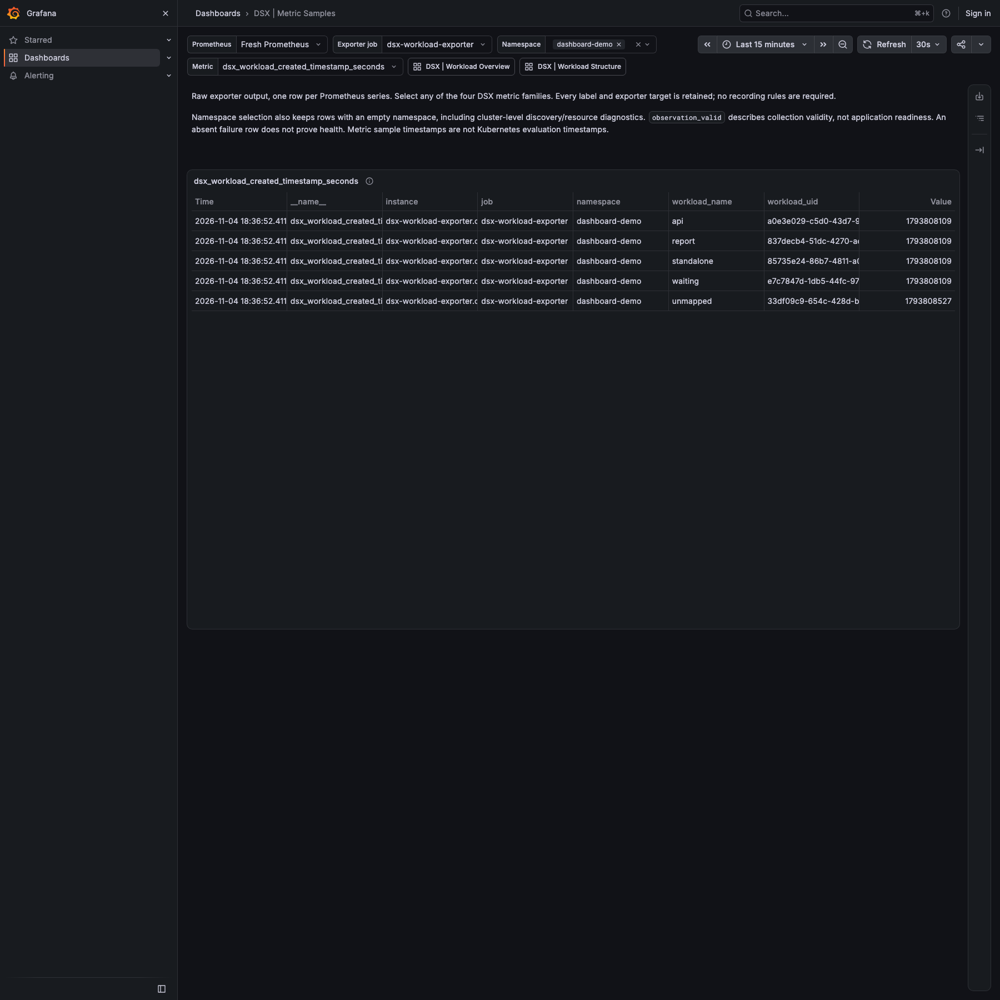
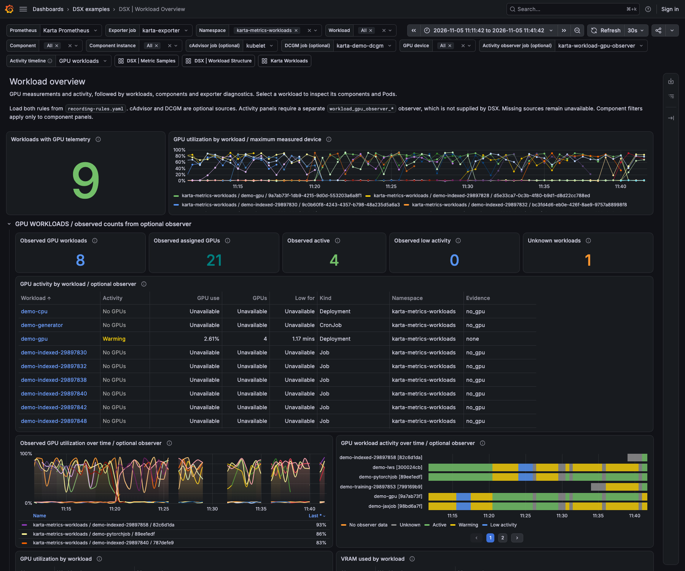
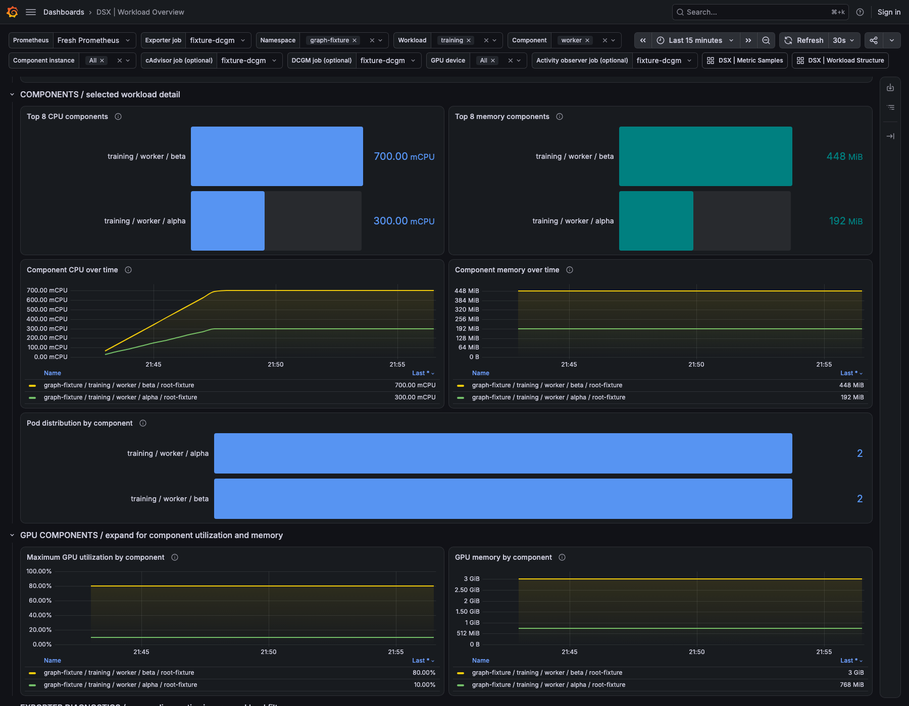
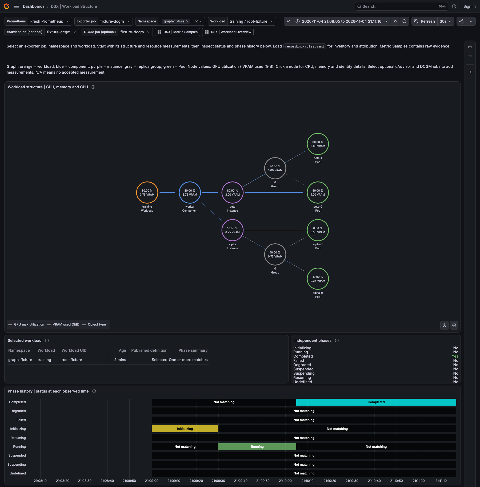
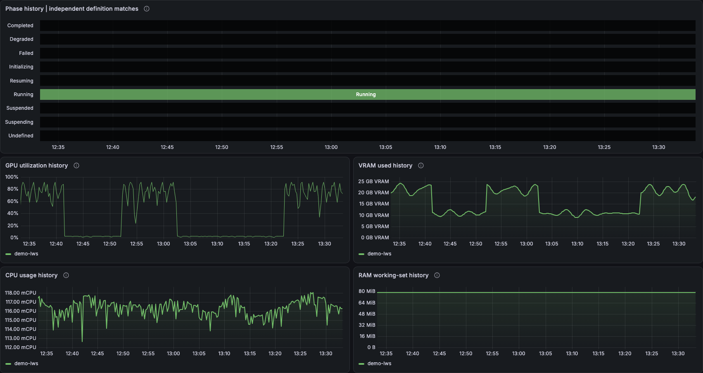

<!-- SPDX-License-Identifier: Apache-2.0 -->
<!-- Copyright (c) 2026 NVIDIA Corporation -->

# Grafana dashboard examples

Find a workload in [Workload Overview](workload-overview.json), then select its
name to inspect [Workload Structure](workload-structure.json). Both dashboards
query raw metrics. They need no recording rules, GPU activity observer or
kube-state-metrics. They can be used with or without the supplied recording rules.

The dashboards use native Grafana panels and refresh every 30 seconds. They are
importable examples for an existing Grafana and Prometheus-compatible backend.
They do not install a metrics collector or storage backend. DSX publishes
workload identity and status. CPU, RAM and GPU measurements come from separate
collectors. Their absence does not prevent workload inventory and structure.

## Set up and import

For collector and Helm configuration examples, follow
[Connect a real cluster](setup.md). For a local example, run
[`hack/demo-grafana-exporter/up.sh`](../../../hack/demo-grafana-exporter/up.sh). The demo uses
simulated full-GPU telemetry and kubelet CPU/RAM metrics; it needs no GPU hardware.

1. [Install the exporter](../../../docs/dsx-workload-exporter/installation.md)
   and configure your metrics collector to scrape it. Confirm that
   `dsx_workload_status` or `dsx_workload_pod_info` returns samples.
2. Add a Prometheus datasource in Grafana. Set its HTTP method to POST and run
   the connection test. The direct activity queries contain long expressions;
   GET requests can exceed URL limits in proxies.
3. Import `workload-overview.json` and `workload-structure.json`. Keep their
   dashboard UIDs so workload links open the matching structure dashboard.
4. Select the datasource. Leave Cluster blank when metrics have no `cluster`
   label. Otherwise enter one exact cluster value before choosing the jobs.
5. Job dropdowns discover names from available metrics. Grafana can select the
   first available value; confirm the exporter job is the intended one. Select
   the CPU/memory and DCGM jobs if those sources are collected.
6. Set DCGM namespace label to the label containing the workload namespace.
   The default is `namespace`. Choose `exported_namespace` when scrape-label
   collisions put the workload namespace there instead.
7. Select namespaces and a time range. Select a workload name in Overview to
   open its structure, or choose a workload UID directly in Structure.

Cluster and job values must be single-line strings without backticks. Filter
values must not contain Grafana variable syntax such as `$__range` or
`${__range}`. Grafana expands these tokens even inside PromQL strings. Normalize
affected labels before ingestion. A plain scrape `job_name`, such as `cadvisor`,
works when it supplies the final `job` label. If `honor_labels` or another rule
preserves a different value, change the source or rule that supplies that label.
Verify the stored job labels with the [source discovery queries](#troubleshoot-missing-panels)
in the dashboard datasource.

Use one exporter job containing replicas of one exporter configuration. For a
backend with several clusters, every selected source must carry the same
`cluster` value. Joins retain this label so identically named Pods in different
clusters are not combined. Blank Cluster selects unlabeled metrics, not every
cluster. If a source uses another cluster-label name, normalize it in the
collector before using these dashboards.

[Metric Samples](metric-samples.json) is an optional troubleshooting dashboard
for the four raw DSX metrics. It also needs no recording rules. Use a datasource
scoped to one cluster when inspecting it.



[recording-rules.yaml](recording-rules.yaml) remains an optional set of reusable
queries. [alerting-rules.yaml](alerting-rules.yaml) is an optional example alert
for an observation failure lasting five minutes. Neither file is needed by the
two main dashboards. Both use native Prometheus rule syntax; for Prometheus
Operator, put their `groups` under a selected `PrometheusRule`'s `spec.groups`.

If provisioning through Kubernetes, use one ConfigMap per dashboard. The pair
exceeds the 1 MiB ConfigMap limit. Use server-side apply for these large JSON
files to avoid the client-side last-applied annotation size limit. Importing
through Grafana does not need ConfigMaps.

## Read the overview

GPU activity comes first. Workload inventory, phase history, resource usage and
component details follow. Inventory and status work without DCGM or cAdvisor.
Expand the detail sections when needed. Component and instance filters apply to
component panels.

These screenshots show an earlier dashboard version. Some labels and activity
panels differ from the current direct-query version.





The activity timeline defaults to workloads with GPU evidence in the selected
time range. Active only and All workloads are also available. Filtering uses
the last observed state and preserves each displayed workload's earlier
transitions. All workloads includes roots without GPU telemetry. Long time ranges
can omit brief transitions because Grafana returns fewer display points. Zoom in
and check that the query step is 30 seconds or less in Query Inspector when
inspecting individual transitions.

Timeline row selection samples the range every 30 seconds, regardless of the
display step. Prometheus defaults to 50 million samples per query. Seven days
across 3,000 workloads already produces about 60.5 million state samples before
other query work. On a sample-limit or timeout error, narrow the range around
the incident and select fewer workloads. Last 1 hour is a starting point for
current telemetry. Actual limits depend on the backend.

## Read the structure

The graph runs from workload to components, instances, replica groups and Pods.
Empty levels are skipped. Use zoom and pan for larger trees. Nodes show maximum
measured GPU activity and framebuffer memory in GB. Click a node for CPU, RAM
and identity details. RAM is container working-set memory, shown in MiB.

The graph uses measurements at the end of the selected time range. Blank values
mean no accepted measurement at that time. Select an earlier end time to inspect
a completed workload while it was running. GPU, VRAM, CPU and RAM history remains
queryable while the backend retains its samples. The exact Pod attribution table
is below the histories.





## Required resource metrics

| Source | Metrics | Required workload labels |
| --- | --- | --- |
| cAdvisor | `container_cpu_usage_seconds_total`, `container_memory_working_set_bytes` | `namespace`, `pod`, `container` |
| DCGM Exporter | `DCGM_FI_DEV_GPU_UTIL`, `DCGM_FI_DEV_FB_USED`; `DCGM_FI_PROF_GR_ENGINE_ACTIVE` for MIG activity | Selected namespace label, nonempty `pod_uid`, nonempty `UUID`; MIG entity labels where applicable |

CPU is a five-minute rate. A newly scraped container needs multiple samples
before a rate appears. Kubelet normally reports `cpu="total"`. Per-core counters
are also supported: replicas must agree for each reported core before its rate
is included in the container sum. A reported total takes precedence over cores.
Conflicting or incomplete readings leave the container unavailable.

Preserve the `cpu` label. A missing label is accepted only for a counter already
known to be a container total. Removing `cpu` from per-core counters does not
produce a total. Memory is working-set bytes. Both sources join Pod names to
DSX attribution and retain the documented
[Pod-name reuse and rate-window limits](../../../docs/dsx-workload-exporter/queries.md#2-cpu-and-memory-by-component-instance-and-group).

GPU queries require device-level readings. Keep DCGM's optional
`--kubernetes-virtual-gpus` mode disabled (`KUBERNETES_VIRTUAL_GPUS=false`, the
default). That mode derives per-Pod utilization and framebuffer values, which
need different aggregation. See the [DCGM implementation](https://github.com/NVIDIA/dcgm-exporter/blob/fafd151148052628061a80450b4ee037a5fa0c3c/internal/pkg/transformation/kubernetes.go#L486-L500).

Enable [DCGM Pod UID mapping](../../../docs/dsx-workload-exporter/queries.md#3-gpu-measurements-by-pod-uid).
GPU joins use Pod UID, not the name of the DCGM exporter Pod. Missing Pod UIDs
cannot be repaired by changing the dashboard's job selector. DCGM Exporter
versions supporting this option need Kubernetes mapping and
`DCGM_EXPORTER_KUBERNETES_ENABLE_POD_UID=true`, plus the required Pod-read RBAC.
Verify the emitted labels after deployment; a healthy scrape alone does not
prove that workload attribution is available.

A compatible metric name is not enough. For example, fake GPU operator 0.0.72
emits DCGM-shaped metrics without `pod_uid`. Its stock output cannot satisfy
these GPU joins. Kind validation used a local test build that added the actual
Pod UID from the operator's cache. No real GPU measurements were used.

Full GPUs use `DCGM_FI_DEV_GPU_UTIL` in percent. MIG instances use
`DCGM_FI_PROF_GR_ENGINE_ACTIVE`, a ratio multiplied by 100. These measure different
forms of activity. MIG samples need `GPU_I_ID`; `GPU_CI_ID` is retained when
available. Parent GPU utilization is excluded when the same Pod and physical GPU
have MIG activity or framebuffer samples. Missing profiling measurements are not
replaced with parent utilization or zero. See
[DCGM metric support](https://docs.nvidia.com/datacenter/dcgm/latest/reference/dcgm-exporter-metrics.html).

Framebuffer measurements are converted from MiB to bytes. Shared GPU entities
count once within each workload or graph node, including MIG identity.
Parent framebuffer rows are excluded when MIG framebuffer rows exist for the
same Pod and physical GPU. Conflicting readings are excluded even when their
GPU index labels differ. These measurements do not isolate a process's
memory or GPU use. Dynamic Resource Allocation (DRA) requires DCGM Exporter
4.8.4 or later with DRA and Pod UID mapping enabled; see the
[DRA setup](setup.md#gpu-measurements-from-dcgm). It uses the same Pod UID join.
Claim labels alone cannot identify the consuming Pod. The dashboards do not
resolve ResourceClaims or verify allocated GPU counts.

## GPU activity states

The dashboard calculates these states from accepted DSX attribution and DCGM
readings. They are not workload phases or metrics emitted by DSX.

| State | Meaning |
| --- | --- |
| Active | At least one accepted GPU activity reading is above 5%. |
| Low activity | All accepted devices have seven quiet evaluation points, 30 seconds apart, covering three minutes. No recently reported device is missing or conflicting. |
| Warming | Current readings are quiet, but the quiet window has not been established. This also applies after recent high activity. |
| Unknown | Current evidence is missing, stale, incomplete or conflicting. |

A raw sample may be at most 90 seconds old at each evaluation point. Short spikes
and scrape gaps between points can be missed. Low activity describes reported
devices; it does not prove application idleness or complete allocation coverage.
The Low window field confirms three sampled minutes, not total elapsed quiet
time. Missing data is not zero, and does not establish that a workload has no
GPUs. Reporting GPU counts describe observed device identities, not allocated
capacity.

## Workload phases and collection health

Phase flags are independent. A workload can match several phases, so the history
keeps one row per phase instead of choosing a priority. The matched-phase count
counts accepted true flags; it does not require a fixed number of phase names.
If replicas disagree on a phase's value or identity, the count is unavailable.
A zero-Pod root remains in the inventory. Current panels can be empty while
historical samples remain available.

Published Pod counts are accepted emitted mappings, not desired replicas or
proof of complete discovery. Inventory can include retained-invalid observations.
An empty failure table means no failure rows were returned, not that discovery
was complete. A zero failure count requires available exporter scrape health.
See the [metric validity limits](../../../docs/keps/0001-metrics-exporter/README.md#metrics).

Attribution queries preserve built-in identity labels and optional `team`.
For other [configured labels](../../../docs/dsx-workload-exporter/configuration.md#configured-labels),
extend the relevant grouping lists and joins if conflicts in those labels must
be detected. An absent `team` label works.

## Troubleshoot missing panels

Start with the panel's query inspector. A query error, such as HTTP 404 or a
backend timeout, is different from a successful query returning no samples.
Check the datasource route and backend limits for errors. Direct history queries
must be supported by the datasource; they can be more expensive than recording
rules at larger workload counts or longer time ranges.

For empty results, first check each source in the same datasource. These queries
list available jobs without assuming a job name. Add an exact `cluster` matcher
when the datasource contains multiple clusters.

```promql
count by (job) (dsx_workload_pod_info{observation_valid="true"})
count by (job) (DCGM_FI_DEV_GPU_UTIL)
count by (job) (DCGM_FI_DEV_GPU_UTIL{pod_uid!="", UUID!=""})
count by (job) (container_cpu_usage_seconds_total{namespace!="", pod!="", container!=""})
count by (job) (container_memory_working_set_bytes{namespace!="", pod!="", container!=""})
```

Run each query separately. GPU readings without any Pod-UID readings explain why
GPU attribution is unavailable. Inspect one raw sample to choose `namespace` or
`exported_namespace`. Pod-UID readings still need matching DSX attribution.
An empty Pod-info result can also be expected for roots with no Pods; check
`dsx_workload_status` for their inventory.

Confirm that relabel or forwarding rules retain the required metrics. For
example, a collector rule dropping `container_.*` removes both CPU and RAM
metrics even if kubelet is scraped. Allow the needed metrics and collect new
samples; the dashboard cannot recover discarded history. Discover and scrape
each exporter endpoint rather than load-balancing scrapes across unrelated
exporter Pods behind a Service.

Unavailable CPU/RAM panels do not invalidate GPU readings or DSX inventory.
Unavailable GPU panels can mean no GPU telemetry, missing Pod UIDs, unsupported
MIG profiling, or rejected attribution. Do not fill these cases with zero.

## Validation

A fresh Kind cluster running Kubernetes 1.34.0 was tested with Prometheus 3.14.0,
Grafana 12.2.1, ten-second scrapes and an exporter built from the same checkout
as the chart.
It had no recording rules or GPU observer. The scrape jobs used independent
names discovered from the metrics. All 69 panel targets and 13 dropdown queries
passed. All 69 targets also completed through Grafana's POST query API, with
time fields for histories. The observation-failure table was empty because no
exporter observation failures were reported.

| Controlled check | Result |
| --- | --- |
| Two GPU Pods at 80%, then 2% | Active, then Warming, then Low activity after the sampled quiet window. |
| Stop the GPU metrics exporter | Both GPU workloads became Unknown. |
| Select absent GPU and CPU/RAM sources | Inventory and graph identities remained available; resource measurements were empty. |
| Deployment with two GPU Pods | Graph edges and GPU, VRAM, CPU and RAM measurements joined the expected nodes. |
| Completed Job, failed Job, root Pod, zero-Pod Deployment | Phases and identities were present; the zero-Pod root had no Pod mappings. |

GPU readings in Kind were simulated by the patched fake GPU operator described
above. CPU and RAM came from kubelet cAdvisor. Nine transformation pipelines
also passed against Grafana 12.2.1 transformation code, including the activity
table and timeline. The graph pipeline needs Grafana application code and was
not executed by that test. Browser rendering, MIG hardware, arbitrary metric
schemas and production-scale query cost remain unverified.

Run the dashboard checks from the repository root:

```sh
make test-exporter-dashboards
make test-exporter-dashboard-queries
```

Both suites use Go and Ginkgo. The second target enables the `promql` build tag
and uses pinned Prometheus 3.14.0 in Docker. To use an installed
`promtool`, set `PROMTOOL=/absolute/path/to/promtool`. It evaluates the shipped
queries against synthetic series for stale samples, label collisions, missing
GPUs, parent/MIG overlap, identity conflicts and the seven-point quiet boundary.
The import suite runs in `make check`. CI runs the query suite only when the
dashboard examples, tests, exporter module dependencies or test/build configuration
change. The query fixtures do not require a cluster.

The earlier recording-rule dashboards were tested on Kind and with full-GPU and
MIG workloads using device-plugin and DRA allocation. Those checks do not prove
all direct-query behavior in this version. Source availability, label mappings,
backend query limits and workload cardinality must also be checked in the target
installation.

To check the optional rule files with an installed `promtool`, run from the
repository root:

```sh
promtool check rules --lint-fatal \
  dsx-workload-exporter/examples/grafana/recording-rules.yaml \
  dsx-workload-exporter/examples/grafana/alerting-rules.yaml
```
