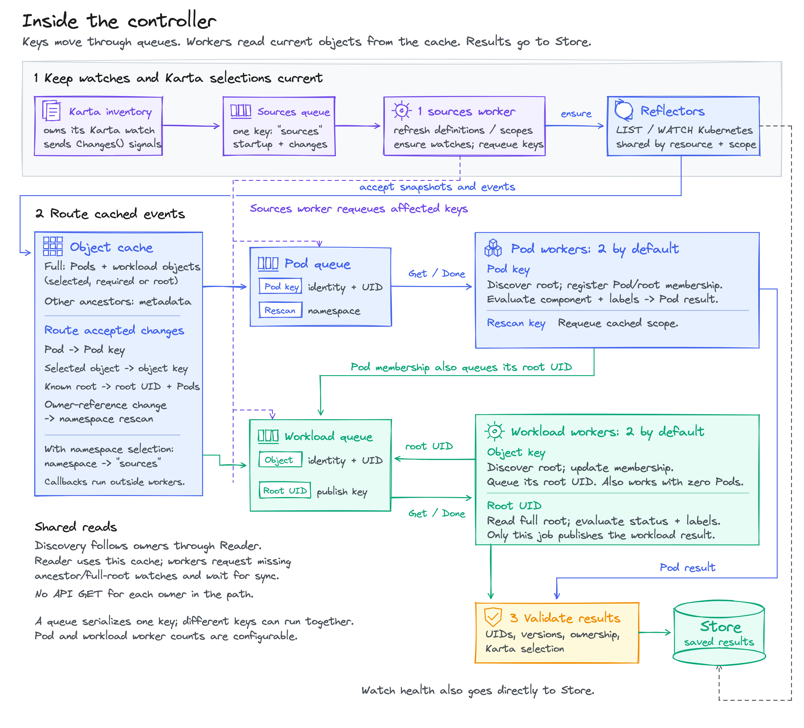

<!-- SPDX-License-Identifier: Apache-2.0 -->
<!-- Copyright (c) 2026 NVIDIA Corporation -->

# Controller

The controller turns Kubernetes events into saved Pod and workload results.
For `Pod api-1 -> ReplicaSet api-rs -> Deployment api`, it saves the Pod's
mapping to `api`. A separate workload job evaluates `api` using its Karta
status mapping, when one exists. Both results go to Store.

## Start and watch

The app waits for the inventory's initial load before calling `Runtime.Run`.
`Runtime.Run` starts workers for three queues. It queues `"sources"`
once at startup and again when inventory reports a change. Inventory owns its
Karta watch; the sources worker reads its latest snapshot.

The sources worker refreshes Karta selections and namespace scopes, then ensures
watches for Pods, selected Karta kinds and configured required kinds. Each
client-go Reflector runs LIST/WATCH in its own goroutine. Its callbacks accept
objects into the cache and enqueue keys independently of the sources worker.

Before expanding selected kinds across namespaces, the sources worker checks API
discovery. An absent API is skipped unless its type was selected with
`kartaDefinitionSource.catalog.include`, `kartaDefinitionSource.cluster.include`
or `requiredKinds`. Skipped types are retried with the existing queue backoff.
Discovery is refreshed at most once every 45 seconds so newly installed APIs can
start watches. A missing API response from an existing watch schedules another
refresh. Absence requires successful discovery of all API resources and no
served version of the group and kind. A version mismatch remains a visible
failure. Incomplete discovery preserves watches and workload results.
Confirmed absence removes that type's watch and stale workload results.
Permission, discovery, LIST/WATCH and evaluation failures remain visible. A live
Pod that still references an absent owner API also retains its observation error.

## Which worker handles what?

Queues hold identities, not object snapshots. Workers read current cached data.

| Queue | Job | Handler and result |
| --- | --- | --- |
| Sources, one worker | `"sources"` | Refresh definitions/scopes, ensure watches and requeue affected work |
| Pods, four workers by default | Pod identity and UID | Discover root, register membership, evaluate component/labels and save Pod result |
| Pods, same worker pool | Namespace rescan | Expand cached objects into ordinary Pod and workload jobs |
| Workloads, four workers by default | Watched-object identity and UID | Discover root, update membership and queue its root UID; works without Pods |
| Workloads, same worker pool | Root UID | Read full root, evaluate status/labels and save or remove workload result |

An object job and a root-UID job share the workload queue, but do different work.
Only the root-UID job publishes a workload result. Registering a Pod under a root
also queues that root UID.

A discovered workload remains published while its root exists and stays in scope,
even after its last Pod or Karta disappears. Karta removal drops status mapping;
generic workload metrics remain. Watches also discover roots without Pods or a
Karta in kinds already being observed, including `requiredKinds`. Types with no
watch still need a selected Karta, `requiredKinds`, or discovery through an owner
chain. Namespace and Karta infrastructure objects are not workload inputs.

Worker counts are configurable. Repeated identical keys are combined. One key
runs on one worker at a time; an update during processing schedules another pass.
Different keys can run concurrently.

## What causes another pass?

| Change | Work queued |
| --- | --- |
| Pod create, update or delete | That Pod's identity |
| Tracked root update | Root UID and its Pods |
| Karta create, update or delete | Refresh sources; requeue workloads and Pods when the selected definition, spec or health changes |
| Namespace labels change (with namespace selection configured) | Sources refresh to recompute watched namespaces |
| Intermediate owner references or root-selector membership change | Namespace rescan |

Discovery requests watches for newly encountered ancestor kinds while resolving
ownership.

## Cache and Store are different

The cache holds Kubernetes objects. Pods, selected/required kinds and evaluated
roots use full objects. Other ancestors start with metadata. `Reader` reads the
cache; discovery does not GET every owner. A full-object replacement watch must
accept its initial snapshot before replacing a metadata watch.

Store holds evaluated results, source health and discovery errors. Before saving
an evaluated result, shared controller state checks the object versions, UIDs,
ownership and selected definitions. Changed inputs trigger another pass instead
of a stale write. Watch health and discovery failures are also written directly
to Store.

One state mutex protects cache, membership and publication checks. Discovery
and expression evaluation run outside it. A separate mutex protects REST-mapper
resets. Queues serialize keys; they do not protect this shared state.

## Failures and shutdown

Watch failures retain the last accepted objects and mark their source unhealthy.
Evaluation failures retain any previous saved value and record an error. Pod
deletion removes its result. Root deletion removes the workload result and
requeues its Pods; a live Pod can retain its last mapping with an owner error.
UID checks distinguish deleted objects from replacements with the same name.

Readiness requires healthy inventory and synchronized required watches.
Cancellation shuts down queues, cancels watches and waits for workers to exit.

## Files

| File | Responsibility |
| --- | --- |
| [runtime.go](runtime.go) | Start workers, receive inventory notifications, report readiness and stop |
| [sources.go](sources.go) | Manage Reflectors, accept events and route queue keys |
| [reader.go](reader.go) | Resolve resource mappings and read cached objects |
| [leaf.go](leaf.go) | Dispatch Pod/rescan jobs and evaluate Pod results |
| [root.go](root.go) | Dispatch watched-object/root-UID jobs and evaluate workloads |
| [state.go](state.go) | Track membership, requeue related work and validate publications |

Run `make check-exporter` from the repository root.
