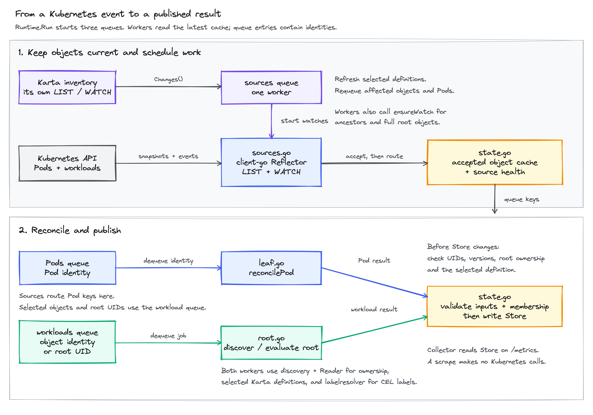

<!-- SPDX-License-Identifier: Apache-2.0 -->
<!-- Copyright (c) 2026 NVIDIA Corporation -->

# Controller

The controller turns Kubernetes changes into Pod mappings and workload results.
For example, `Pod api-1 -> ReplicaSet api-rs -> Deployment api` produces a Pod
record pointing to `api` and a workload record. A selected Karta definition
supplies the Deployment's status when it defines status mapping.
The collector reads these saved results when Prometheus scrapes `/metrics`.

[Diagram source](images/controller-flow.excalidraw)

## Follow one event

1. `Runtime.Run` starts the Pod, workload and sources queues. The application
   runs the Karta inventory alongside it. Inventory owns its Karta watch.
2. A client-go Reflector performs LIST/WATCH for each resource and namespace scope.
   `sources.go` accepts object changes into the cache and queues their identities.
3. A Pod worker reads the full Pod. Discovery follows its controller owner
   references through `Reader` until it finds a root or an ignored owner kind.
4. The worker registers the Pod under that root. It reads the full root, uses its
   Karta definition for component mapping, and evaluates labels with the full
   Pod and root as inputs. A root-UID job separately evaluates workload status.
5. `state.go` checks that the objects, ownership and definition are still current
   before saving a result. Changed inputs cause a retry instead of a stale write.

Objects matching a selected Karta kind also enter the workload queue without
Pods. These jobs discover a root and register membership; root-UID jobs publish
or remove the workload result.

## Where to look

| File | Responsibility |
| --- | --- |
| [runtime.go](runtime.go) | Start workers, receive definition changes, report readiness and stop |
| [sources.go](sources.go) | Maintain Reflectors, accept snapshots/events and route queue keys |
| [reader.go](reader.go) | Resolve resource mappings and read accepted cached objects |
| [leaf.go](leaf.go) | Discover a Pod's root and evaluate its mapping and labels |
| [root.go](root.go) | Discover selected objects and evaluate root status and labels |
| [state.go](state.go) | Keep membership and publish only results with current inputs |

## Cache, queues and changes

Pods and evaluated roots are cached in full. Other ancestors need only metadata.
If an ancestor becomes a root, its metadata watch stays active until a full-object
replacement has synchronized. Discovery waits for that cache; it does not GET
every owner from the API server.

There is one sources worker. Pod and workload queues each default to two workers.
A queue serializes a key, but callbacks and different keys still share state.
One state mutex protects cache acceptance, membership and publication checks.
Discovery and expression evaluation run outside it. A separate reader mutex
protects REST-mapper resets.

Karta changes requeue affected objects and Pods. Root changes requeue that root
and its members. Intermediate owner changes rescan the relevant cached scope.
Selector settings are fixed at startup; changes to object or Namespace labels
still affect which objects are selected.

## Failures and shutdown

Failed watches retain the last accepted objects and record unhealthy sources.
Failed evaluations retain any previous value with an error. Confirmed Pod
deletion removes its result. Root deletion removes the workload result and
requeues its Pods; a live Pod may keep its last mapping with an owner error.
UID checks prevent a recreated object from satisfying an old owner reference.

Readiness requires healthy inventory and synchronized required watches. On
cancellation, the application stops HTTP serving, cancels inventory and watches,
joins workers, unregisters collection and shuts down the metrics provider.

Run `make check-exporter` from the repository root.
